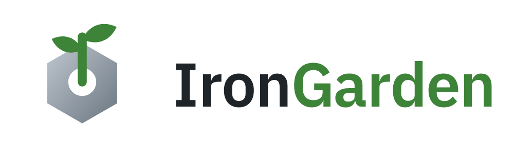

<p align="center">
  <picture>
    <source media="(prefers-color-scheme: dark)" srcset="docs/assets/wordmark-dark.png">
    
  </picture>
</p>

[](https://deploy.workers.cloudflare.com/?url=https://github.com/alonbardavid/iron-garden)

A git platform reimagined for both Agents and Humans.

Feature highlights:

- 1 click deploy to Cloudflare
- Fully featured git workflows
- Use your own agents or Cloudflare AI Gateway for everything
- Chat with your own agents from the web app directly in the review context
- Structured code reviews following agent comments
- Review lines and ranges, not files
- Focus on code that matters - auto-accept rules, reference implementation
- Easy GitHub integration
- Ready to expand with [edge-stack](https://github.com/alonbardavid/edge-stack) foundation -
  modern development workflows for customization

## Deploy

IronGarden runs on your own Cloudflare account, on the **Workers Paid** plan (Cloudflare
Artifacts, which stores every repository, needs it).

1. Click **Deploy to Cloudflare** above. Cloudflare copies this repository into your GitHub
   account, creates the database and the other resources, and deploys the Worker. Keep the
   defaults — a production Worker named `iron-garden` with a D1 database `iron-garden-prod`,
   built with `pnpm run build` and deployed with `pnpm run deploy` — or rename them.
2. Fill in the secret it asks for, `SETUP_TOKEN`: any random string of 4 characters or
   more. You type it once, to create the first admin. The first deploy generates
   `BETTER_AUTH_SECRET`, which signs sessions and encrypts stored GitHub tokens.
3. When the deploy finishes, open the Worker's URL
   (`https://iron-garden.<your-subdomain>.workers.dev`).
4. The first visit shows the setup form: enter `SETUP_TOKEN` and the first admin's details.
   The form turns itself off once an admin exists; add everyone else under _Admin_.

Every push to your copy's `main` redeploys it. Email and AI processing are optional, and set
up later from the admin settings. For a custom domain, attach it to the Worker in Cloudflare
and set a `PROD_HOST` build variable (the hostname, no scheme) under the Worker's _Settings >
Build_. See [deployment](docs/deployment.md) for the details.

## Local development

```bash
pnpm install
pnpm dev          # builds, then runs the app at http://localhost:5173
pnpm test         # Playwright e2e (run `pnpm --filter tests exec playwright install` once)
```

The first-run form takes the local `SETUP_TOKEN`, `local-dev-setup-token-7c41e9a2b85d`.

Git hosting needs the real Cloudflare Artifacts service, which has no local simulator. Give
the dev server a Cloudflare API token with **Artifacts: Edit**:

```bash
export CLOUDFLARE_API_TOKEN=...
ARTIFACTS_NAMESPACE=iron-garden-dev-$USER pnpm dev
```

To work on IronGarden itself, use the modern development workflow that comes with
[edge-stack](https://github.com/alonbardavid/edge-stack): add `CLOUDFLARE_API_TOKEN` and
`CLOUDFLARE_ACCOUNT_ID` as secrets of your GitHub repository (and, optionally, `PROD_HOST` as
a variable); until the token is set, the deploy workflows skip. Then every branch gets its own live preview, with its own database and
repositories and its URL commented on the pull request; every pull request runs the e2e
suite; and `main` deploys to staging and production. See
[development](docs/development.md) and [deployment](docs/deployment.md) for the one-time setup.

## Docs

- [Architecture](docs/architecture.md) — layout, the API contract, identity and keys, git hosting, agent sessions, GitHub
- [Logging](libs/logging/README.md) — `moduleLogger`, request context, verbosity
- [Diff](libs/diff/README.md) — the line diff and the changes a reviewer accepts
- [Development](docs/development.md) — local dev, the build, local D1
- [Deployment](docs/deployment.md) — preview, staging and production
- [Emails](docs/emails.md) — templates, sending, turning email on
- [Tests](tests/README.md) — e2e traps
- [Decisions](docs/adrs/) — architecture decision records
