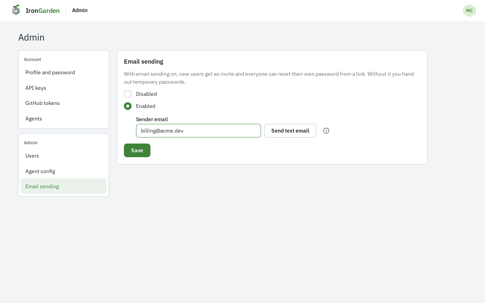
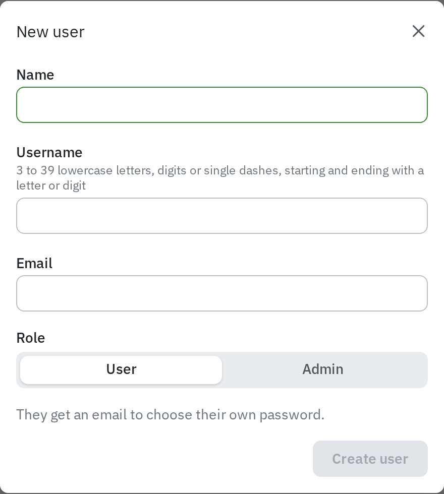

Email is off on a new instance. With it on, new users get an invite by email and anyone can
reset a forgotten password from the sign-in page. With it off, admins hand out temporary
passwords instead. An instance admin turns it on under **Admin › Email sending**.

Mail goes out through [Cloudflare Email Service](https://developers.cloudflare.com/email-service/),
which every deploy already binds. What it needs from you is a sending domain.

## Set up a sending domain

The sender address must be on a domain onboarded to Cloudflare Email Service. The domain
must use Cloudflare DNS, and sending needs the **Workers Paid** plan.

1. In the Cloudflare dashboard, open **Compute › Email Service › Email Sending** and select
   **Onboard Domain**.
2. Choose your domain. Cloudflare adds the DNS records it needs (MX, SPF and DKIM on
   `cf-bounce`, and DMARC). They usually take a few minutes to apply.

The info icon beside the sender field in %PRODUCT_NAME% shows these same steps.

## Turn email on

1. Open **Admin › Email sending**.
2. Choose **Enabled**.
3. Enter the **Sender email**, an address on your onboarded domain such as
   `noreply@yourdomain.com`.
4. Select **Send test email**. It goes to your own address, from the sender you typed, and
   saves nothing.
5. Once it arrives, select **Save**.

To turn email off again, choose **Disabled** and select **Save**.

## What changes with email on or off

|                                                                       | Email on                                                                                                       | Email off                                                                                                                                                           |
| --------------------------------------------------------------------- | -------------------------------------------------------------------------------------------------------------- | ------------------------------------------------------------------------------------------------------------------------------------------------------------------- |
| **Adding a user** (Admin › Users › New user)                          | The user gets an invite email to choose their own password. They show as **Invitation pending** until they do. | %PRODUCT_NAME% shows a temporary password once. Give it to the user; they choose their own when they first sign in. They show as **Temporary password** until then. |
| **Invite link**                                                       | Lasts 7 days. Following it sets the password and signs the user in.                                            | —                                                                                                                                                                   |
| **Forgotten password**                                                | The sign-in page has **Forgot password?**, which emails a reset link.                                          | The sign-in page says to ask an admin for a temporary one.                                                                                                          |
| **Admin resets a password** (Admin › Users › Manage › Reset password) | A temporary password, shown once.                                                                              | A temporary password, shown once.                                                                                                                                   |

Sign-up is always off: users exist only when an admin adds them.

Turning email on or off takes effect at once, without a redeploy.

:::caution
While email is off, invite and reset links already sent stop working. Give anyone still
**Invitation pending** a temporary password with **Manage › Reset password** on **Admin › Users**.
:::

