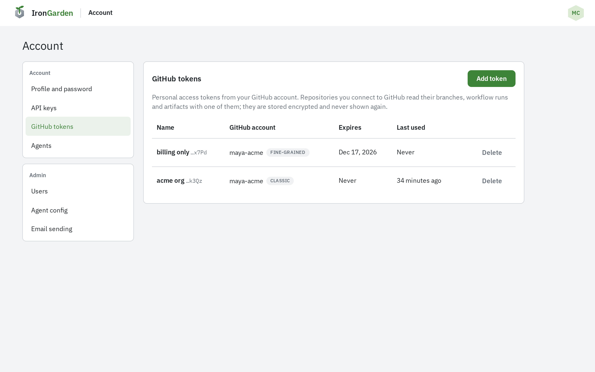
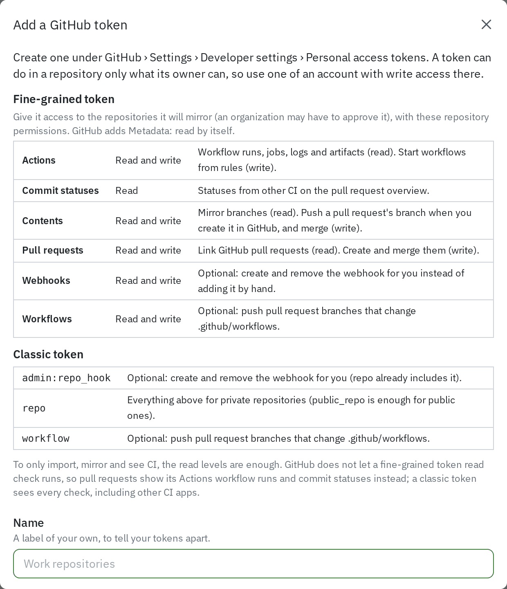
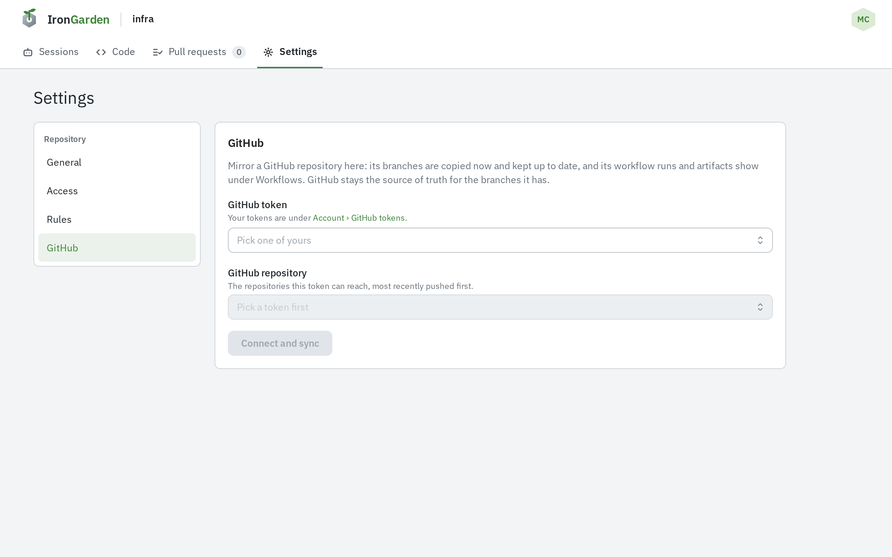
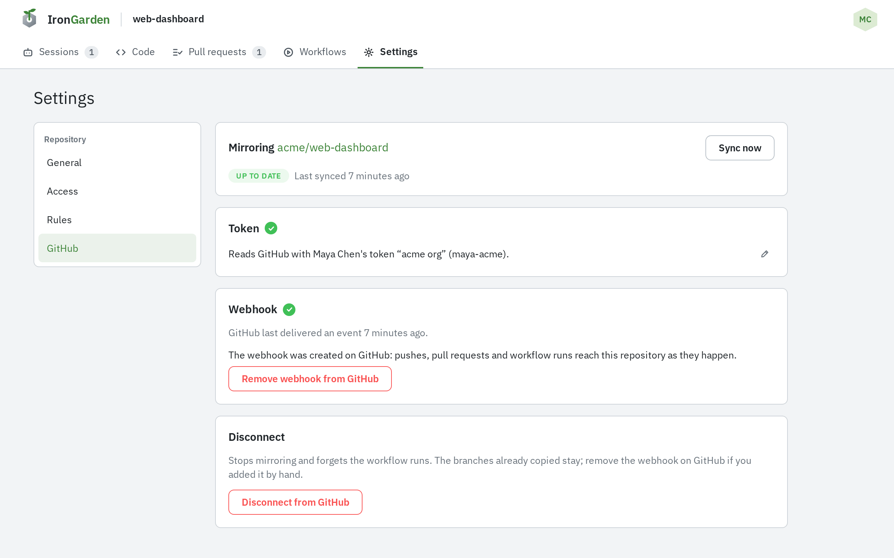
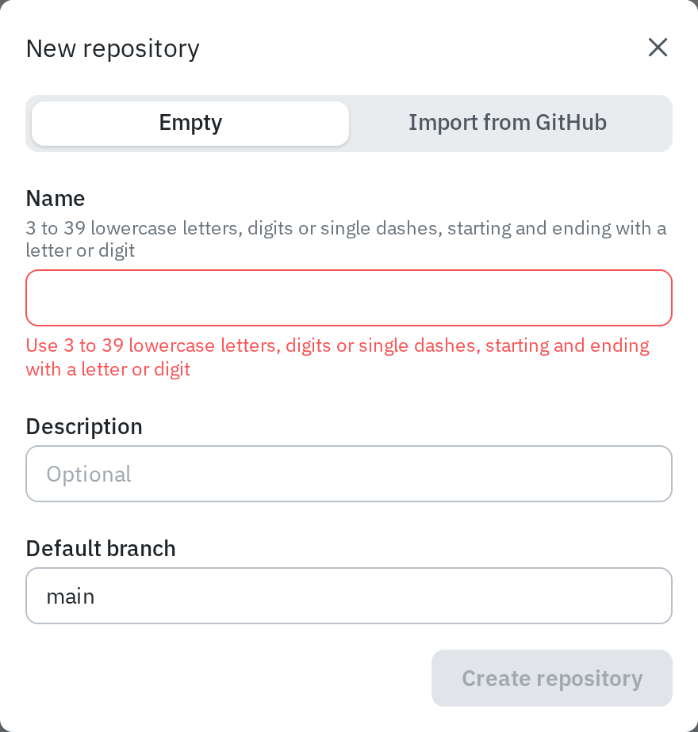
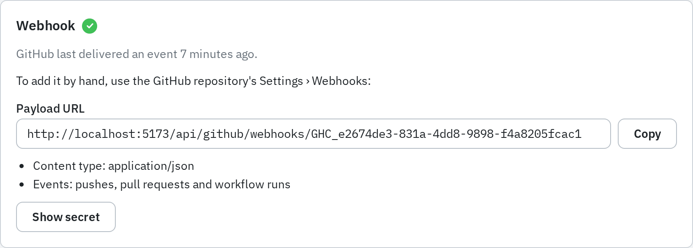

%PRODUCT_NAME% talks to GitHub with personal access tokens that people add to their own
account. There is no GitHub App or OAuth app to register. A repository is then connected to
one GitHub repository with one of those tokens, and a webhook keeps it current.

What a connected repository does for its users is in
[GitHub integration](/capabilities/github-integration/).

## Personal access tokens

Each person adds their own tokens under **Account › GitHub tokens**. Agents never hold one.

1. On GitHub, create a token under **Settings › Developer settings › Personal access
   tokens**. Use an account with write access to the repositories it will be used for.
2. In %PRODUCT_NAME%, open **Account › GitHub tokens** and select **Add token**.
3. Give it a **Name** of your own and paste the **Token**.
4. Select **Add token**. The token is checked against GitHub before it is saved.

The list shows each token's name and last characters, its GitHub account, whether it is
**Classic** or **Fine-grained**, when it expires and when it was last used. A token is
never shown again after it is added. **Delete** removes it.

### Fine-grained or classic

Both work.

- A **fine-grained** token is limited to the repositories you grant it, and an organization
  may have to approve it. GitHub does not let it read check runs, so pull requests show
  Actions workflow runs and commit statuses instead of checks.
- A **classic** token sees every check, including other CI apps.

To only import, mirror and see CI, the read levels are enough.

### Fine-grained token permissions

Give the token access to the repositories it will mirror, with these repository
permissions. GitHub adds **Metadata: Read** by itself.

| Permission      | Access         | Used for                                                                                              |
| --------------- | -------------- | ----------------------------------------------------------------------------------------------------- |
| Actions         | Read and write | Workflow runs, jobs, logs and artifacts (read). Start workflows from rules (write).                   |
| Commit statuses | Read           | Statuses from other CI on the pull request overview.                                                  |
| Contents        | Read and write | Mirror branches (read). Push a pull request's branch when you create it in GitHub, and merge (write). |
| Pull requests   | Read and write | Link GitHub pull requests (read). Create and merge them (write).                                      |
| Webhooks        | Read and write | Optional: create and remove the webhook for you instead of adding it by hand.                         |
| Workflows       | Read and write | Optional: push pull request branches that change `.github/workflows`.                                 |

### Classic token scopes

| Scope             | Used for                                                                             |
| ----------------- | ------------------------------------------------------------------------------------ |
| `repo`            | Everything above for private repositories (`public_repo` is enough for public ones). |
| `admin:repo_hook` | Optional: create and remove the webhook for you (`repo` already includes it).        |
| `workflow`        | Optional: push pull request branches that change `.github/workflows`.                |

## Connecting a repository

A repository admin connects an existing repository. Git hosting must be available, as for
any repository.

1. Open the repository's **Settings › GitHub**.
2. Pick one of your tokens in **GitHub token**.
3. Pick the **GitHub repository**. The list holds the repositories that token can reach,
   most recently pushed first.
4. Select **Connect and sync**.

Every branch is copied at once. The page then shows **Mirroring owner/repo**, its sync state
(**Up to date**, **Syncing**, **Sync failed** with the reason, or **Not synced**), when it
last synced, and **Sync now** for a full sync.

## Importing a repository

Instance admins can create a repository straight from GitHub.

1. On the repositories page, select **New repository**.
2. Choose **Import from GitHub**.
3. Pick a **GitHub token** and a **GitHub repository**. The **Name** fills in from the
   GitHub repository; change it if you like.
4. Select **Import repository**.

The new repository takes the GitHub repository's default branch and description, and is
connected to it as above. Set up the webhook next.

## The webhook

Connecting never creates the webhook. Without it, branches, pull requests and workflow runs
change here only when someone selects **Sync now**. The **Webhook** card on
**Settings › GitHub** sets it up in one of two ways.

### Let %PRODUCT_NAME% create it

When the connection's token looks able to, the card offers **Set up webhook on GitHub**.
That needs:

- the token's GitHub account to be an admin of the GitHub repository, and
- a classic token with `repo` or `admin:repo_hook`, or a fine-grained token with
  **Webhooks: Read and write**.

Once created, **Remove webhook from GitHub** deletes it again. If the token cannot create
it, the card says what is missing.

### Add it by hand

The card shows what to enter in the GitHub repository's **Settings › Webhooks**:

| GitHub field | Value                                                                         |
| ------------ | ----------------------------------------------------------------------------- |
| Payload URL  | The URL shown on the card, `https://<your host>/api/github/webhooks/<id>`     |
| Content type | `application/json`                                                            |
| Secret       | Select **Show secret** on the card and copy it                                |
| Events       | Choose individual events: **Pushes**, **Pull requests** and **Workflow runs** |

Each connection has its own URL and secret. Deliveries with a wrong signature are
refused. Once GitHub delivers an event, the card shows when it last did.

:::note
The payload URL uses the instance's hostname. If that hostname changes, for example moving
off a `workers.dev` address, re-create the webhook on every connected repository.
:::

## Changing the token

The connection reads GitHub with the token of the person who connected it. To move it to
another token, use the edit icon on the **Token** card of **Settings › GitHub**.

## Disconnecting

**Disconnect from GitHub** on **Settings › GitHub** stops mirroring and forgets the
workflow runs. The branches already copied stay. If you added the webhook by hand, remove it
on GitHub as well.
