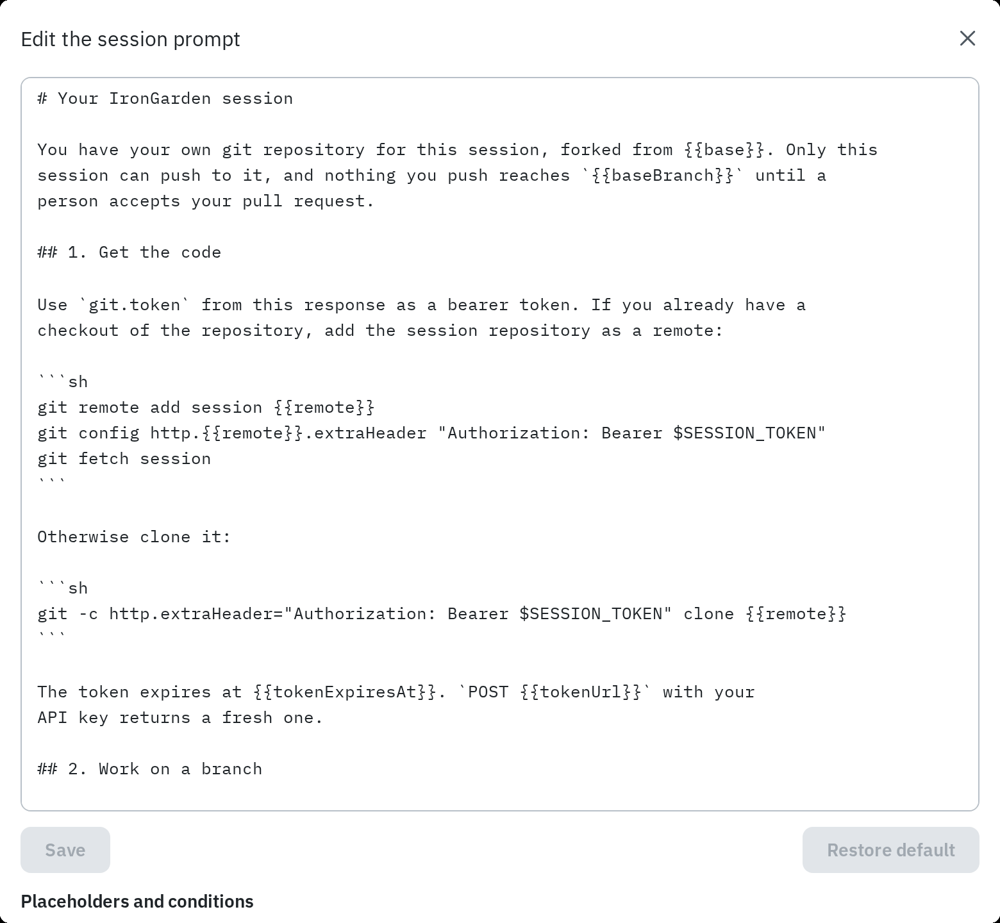

Agents work from two prompts the instance hands them: the **session prompt** when a session
starts, and the **processing prompt** when a pull request needs bracketing. Both have
built-in defaults. An instance admin can rewrite either under **Admin › Agent config**.

## The two prompts

| Prompt                | Who reads it                                                                                                                            | When it is filled in                                                                                                   |
| --------------------- | --------------------------------------------------------------------------------------------------------------------------------------- | ---------------------------------------------------------------------------------------------------------------------- |
| **Session prompt**    | An agent starting a session: how to get the code, open a pull request, share how it worked, and answer reviewers.                       | When the session starts. Sessions already running keep the prompt they were given.                                     |
| **Processing prompt** | Whoever processes a new pull request: its agent, or the server's model (see [Server agent setup](/administration/server-agent-setup/)). | For each revision: in the agent's response when it opens or refreshes the pull request, or when the server's job runs. |

Both are instance settings. Changing one affects every repository.

## Editing a prompt

1. Open **Admin › Agent config** and scroll to the **Session prompt** or **Processing
   prompt** card. Each shows the prompt as it is now, and whether it is the built-in
   default or was customized.
2. Select the edit icon.
3. Change the text. Below it, **Placeholders and conditions** lists everything this prompt
   can use.
4. Select **Save**.

**Restore default** in the same editor goes back to the built-in default. A prompt can be
up to 50,000 characters.



## Template syntax

Both prompts are templates.

- `{{name}}` is a placeholder, replaced with its value each time the prompt is filled in.
  A name the prompt does not know is left as written.
- `{{#if name}}…{{/if}}` keeps its text only when the condition holds.
- `{{#if name}}…{{else}}…{{/if}}` keeps one branch and drops the other.
- An unknown condition counts as false.
- Blocks can be nested.
- A `{{#if …}}`, `{{else}}` or `{{/if}}` tag alone on its line takes the line with it.

## Session prompt reference

### Placeholders

| Placeholder           | Replaced with                                                          |
| --------------------- | ---------------------------------------------------------------------- |
| `{{base}}`            | The branch and commit the session repository was forked from           |
| `{{baseBranch}}`      | The repository's default branch, the session's base                    |
| `{{remote}}`          | The session repository's git remote                                    |
| `{{tokenExpiresAt}}`  | When the git token in the response expires                             |
| `{{tokenUrl}}`        | Where to POST for a fresh git token                                    |
| `{{sessionUrl}}`      | Where to PATCH the session's title, goal and context                   |
| `{{pullRequestsUrl}}` | Where to POST a pull request                                           |
| `{{transcriptsUrl}}`  | Where to POST a transcript or an outline of the work                   |
| `{{endUrl}}`          | Where to POST to end the session                                       |
| `{{activityUrl}}`     | Where to POST the files the agent is editing                           |
| `{{listenUrl}}`       | Where to POST for fresh listener URLs                                  |
| `{{messagesUrl}}`     | Where to POST a message to another session                             |
| `{{chatUrl}}`         | Where to POST an answer to the person chatting from the session's page |

### Conditions

| Condition              | True when                                                                                            |
| ---------------------- | ---------------------------------------------------------------------------------------------------- |
| `{{#if claude}}`       | The agent is Claude: it named itself so when it started its session, or its requests say so.         |
| `{{#if serverGroups}}` | The server processes pull requests, so the agent gets no processing prompt and cannot send brackets. |
| `{{#if messaging}}`    | Sessions may message each other and publish contacts (**Sessions can talk to each other** is on).    |

## Processing prompt reference

### Placeholders

Every processing prompt can use these:

| Placeholder        | Replaced with                                                                                      |
| ------------------ | -------------------------------------------------------------------------------------------------- |
| `{{repository}}`   | Repository name                                                                                    |
| `{{number}}`       | Pull request number                                                                                |
| `{{title}}`        | Pull request title                                                                                 |
| `{{description}}`  | Pull request description, or `(none)`                                                              |
| `{{branch}}`       | The branch under review                                                                            |
| `{{baseCommit}}`   | Commit the branch is compared with, where it leaves the target branch                              |
| `{{headCommit}}`   | Commit at the head of the branch                                                                   |
| `{{changedFiles}}` | One line per changed file: path, change and line count                                             |
| `{{rules}}`        | The repository's [rules](/administration/rules/), what each does and the ones to judge, or nothing |

When agents process pull requests, these are also available:

| Placeholder       | Replaced with                                    |
| ----------------- | ------------------------------------------------ |
| `{{submitUrl}}`   | Where to PUT the brackets                        |
| `{{commentsUrl}}` | Where the agent POSTs a comment explaining lines |

When the server processes them, these are available instead:

| Placeholder       | Replaced with                                                                                                                                          |
| ----------------- | ------------------------------------------------------------------------------------------------------------------------------------------------------ |
| `{{changes}}`     | Every changed file's diff, numbered on both sides, with a few unchanged lines around each change                                                       |
| `{{transcripts}}` | The conversations in which the agent made the change, from the transcripts on its commits: their latest words, up to the transcript limit, or `(none)` |

:::note
A prompt that leaves out `{{rules}}` still gets the rules: they are added at the end
whenever the pull request has any. Keep `{{rules}}` in to choose where they go.
:::

### Conditions

When agents process pull requests, the processing prompt can test `{{#if claude}}`. `serverGroups` and
`messaging` are always false here. When the server processes them, every condition is false.

## The processing prompt follows the processing mode

There is one processing prompt setting for both ways of bracketing.

- **While no admin has written one**, it is the built-in default of the current mode: the
  agent default while agents process pull requests, the server default while the server does. The
  **Processing prompt** card follows the choice in **Pull request processing**, even
  before you save it.
- **Once an admin has written one**, it is kept as it is when the mode changes. When you
  switch modes with a customized prompt, the **Pull request processing** card warns that **The
  processing prompt was edited** and offers **Use the server default** (or **Use the agent
  default**).

The processing prompt editor shows the default and the placeholders of the mode currently
chosen on the page. The text you save is used whichever mode is on. **Restore default**
goes back to following the current mode's default.

## Example

A team wants every agent to run its checks before opening a pull request, and Claude to
bracket in a subagent. Added to the session prompt,
before the section on opening a pull request:

```text
## House rules

- Run `pnpm lint` and `pnpm test` in your checkout before you push, and fix what fails.
- Never push changes to files under `migrations/` that are already on {{baseBranch}}.
{{#if serverGroups}}
- The server splits your pull request into brackets; you do not need to.
{{else}}
{{#if claude}}
- Follow the processing prompt in a subagent, and keep your own context on the task.
{{/if}}
{{/if}}
```

And to the processing prompt:

```text
Put every change under docs/ in one bracket of its own, titled "Documentation".
```

Check a change by starting a session and reading the prompt it gets back. To undo it,
open the editor and select **Restore default**.
