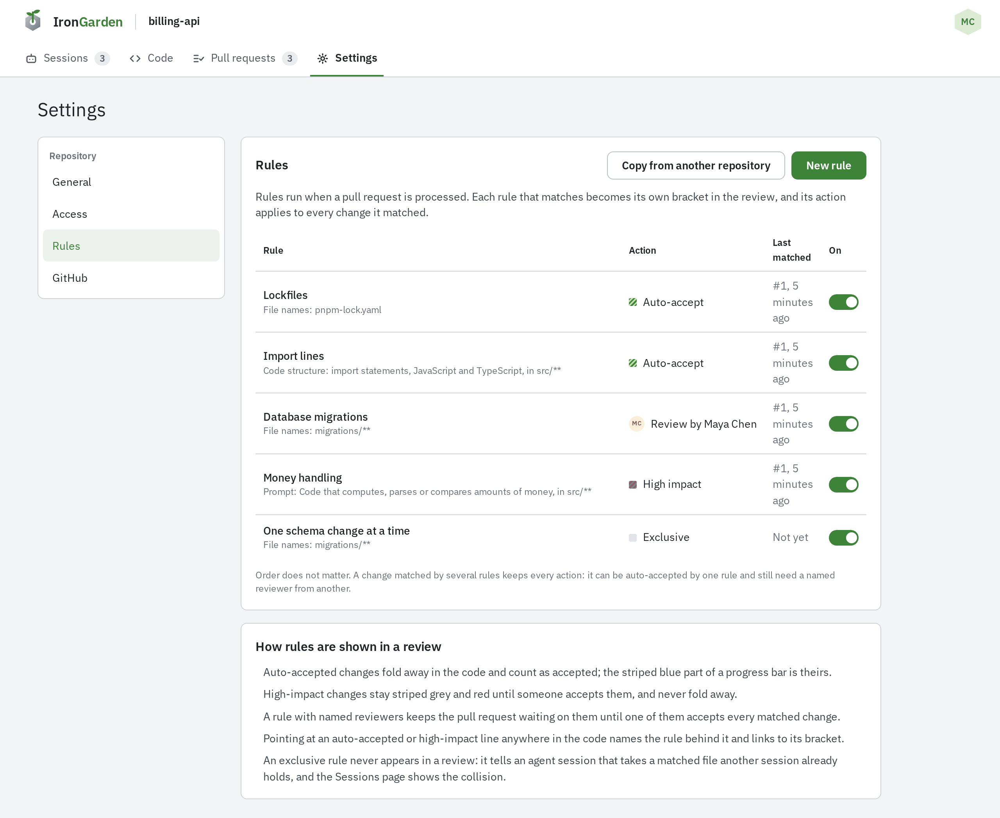
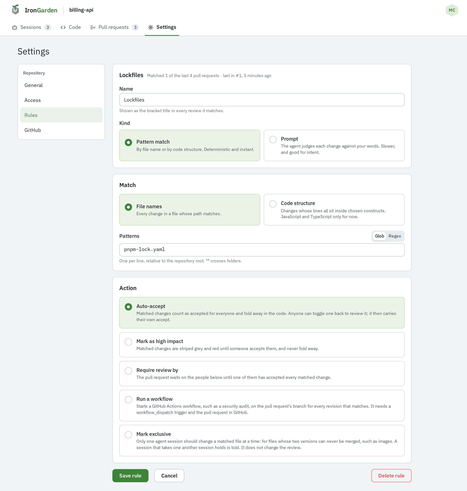
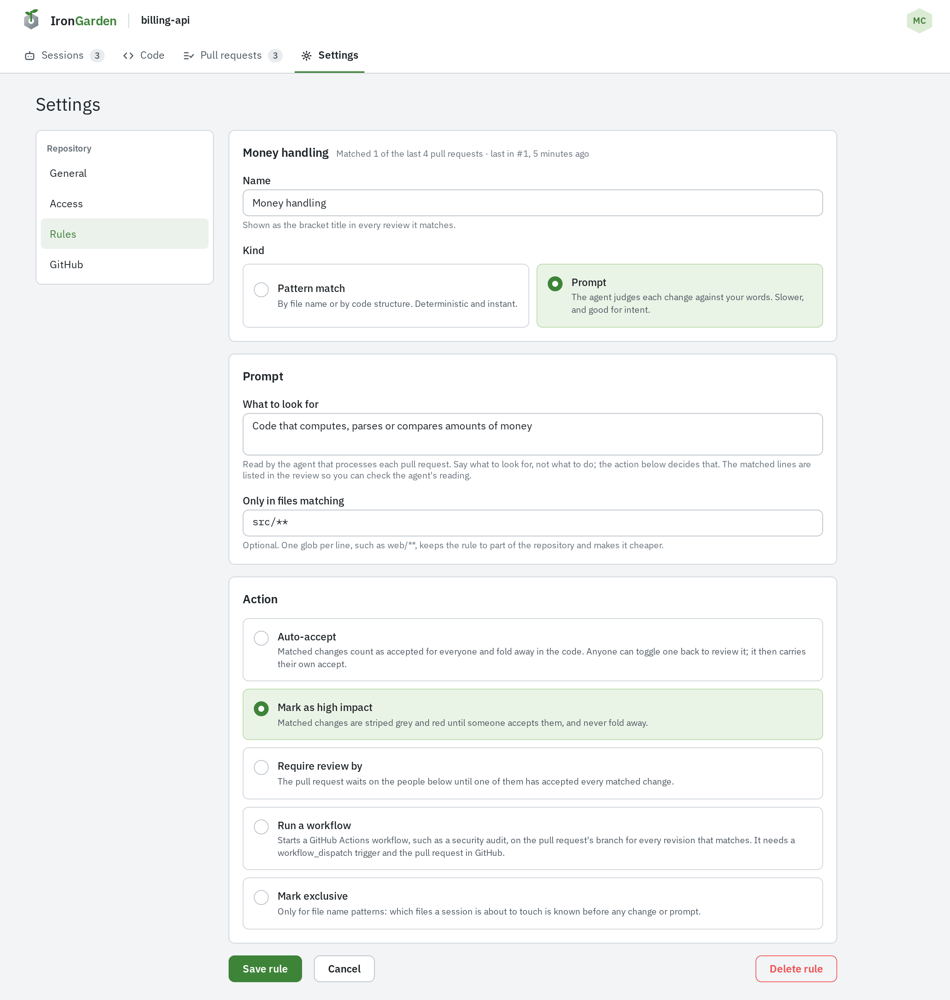
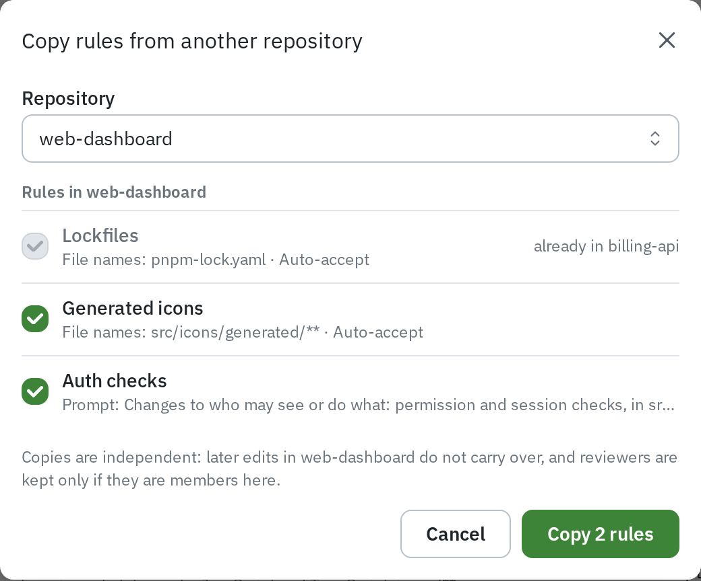

Rules tell the review what to do with certain changes before anyone reads them: accept
lockfiles, flag migrations as high impact, require a named reviewer, start a GitHub
workflow, or keep agent sessions off each other's files. Each rule that matches becomes its
own bracket in the review.

Rules belong to a repository. Repository admins manage them under **Settings › Rules**. For
how matched changes look to a reviewer, see
[Confidence levels](/code-review/confidence-levels/).

## The rules list

**Settings › Rules** lists every rule with what it matches, its action, the pull request it
**Last matched**, and an **On** switch. Turning a rule off keeps it but stops it running on
new revisions.

Order does not matter. A change matched by several rules keeps every action: it can be
auto-accepted by one rule and still need a named reviewer from another.

## Creating a rule

1. Select **New rule**.
2. Enter a **Name**. It is the bracket title in every review the rule matches.
3. Choose the **Kind**: **Pattern match** or **Prompt**.
4. Fill in the match (below).
5. Choose the **Action** (below).
6. Select **Create rule**.

A rule's page also shows how many of the repository's recent pull requests it matched.
**Delete rule** removes it; pull requests already processed keep it in their review.

## Pattern rules and prompt rules

A **pattern rule** is deterministic and instant. It matches in one of two ways:

- **File names**: every change in a file whose path matches. Choose **Glob** or **Regex**.
- **Code structure**: changes whose lines all sit inside the chosen constructs, in
  JavaScript and TypeScript files only.

A **prompt rule** describes in words what to look for. Whoever processes the pull request
(its agent, or the server's model) judges each change against it. It is slower. The matched lines
are listed in the review.

### Match fields

| Field                      | Applies to             | What to enter                                                                                                                                                                                                               |
| -------------------------- | ---------------------- | --------------------------------------------------------------------------------------------------------------------------------------------------------------------------------------------------------------------------- |
| **Patterns**, Glob         | File names             | One per line, relative to the repository root. `*` and `?` stay inside a folder, `**` crosses folders, `{a,b}` is either.                                                                                                   |
| **Patterns**, Regex        | File names             | One per line. Each is searched for anywhere in the path.                                                                                                                                                                    |
| **Constructs**             | Code structure         | **Import statements** (`import`, `export … from` and `require()` lines: adding, removing or reordering them) and/or **Comments** (line and block comments, JSDoc included; a change that also touches code does not match). |
| **What to look for**       | Prompt                 | What to look for, not what to do; the action decides that. Up to 5,000 characters.                                                                                                                                          |
| **Only in files matching** | Code structure, Prompt | Optional. One glob per line, such as `web/**`. Keeps the rule to part of the repository.                                                                                                                                    |

A glob must match the whole path: `*.lock` matches only at the root, while `**/*.lock`
matches in any folder. A rule takes up to 50 patterns.

## Actions

| Action                  | In the list | What it does                                                                                                                                                                                                                             |
| ----------------------- | ----------- | ---------------------------------------------------------------------------------------------------------------------------------------------------------------------------------------------------------------------------------------- |
| **Auto-accept**         | Auto-accept | Matched changes count as accepted for everyone and fold away in the code. Anyone can toggle one back to review it; it then carries their own accept.                                                                                     |
| **Mark as high impact** | High impact | Matched changes are striped grey and red until someone accepts them, and never fold away.                                                                                                                                                |
| **Require review by**   | Review by … | The pull request waits on the named **Reviewers** until one of them has accepted every matched change. Reviewers are members of the repository (up to 20); someone who loses access is skipped.                                          |
| **Run a workflow**      | Runs …      | Starts a GitHub Actions **Workflow** of the connected repository on the pull request's branch, for every revision that matches. Needs the repository connected to GitHub, a `workflow_dispatch` trigger, and the pull request on GitHub. |
| **Mark exclusive**      | Exclusive   | Only one agent session should change a matched file at a time. A session that takes a file another session holds is told, and the Sessions page shows the collision. It does not appear in a review. **File names** rules only.          |

Run-workflow rules are described further in
[GitHub integration](/capabilities/github-integration/#run-workflow-rules). Collisions from
exclusive files are covered in
[Managing agents and sessions](/agent-workflows/agents-and-sessions/).

## When rules take effect

The repository's rules that are on are copied onto a pull request each time a new revision
is stored. Editing, turning off or deleting a rule never changes a review already in
progress; it applies from the next revision. Exclusive rules are not copied: they act on
sessions while they work.

## Copying rules between repositories

1. On **Settings › Rules**, select **Copy from another repository**.
2. Pick the **Repository** to copy from. You need read access to it.
3. Tick the rules to copy. A rule with the same name and match already here is shown as
   **already in** this repository and cannot be ticked.
4. Select **Copy N rules**.

Copies are independent: later edits in the other repository do not carry over. Reviewers
are kept only if they are members here too.

A **Run a workflow** rule is copied only if this repository is connected to GitHub and its
GitHub repository has a workflow at the same path. The others are left out, and **Some rules
were not copied** lists them.

## Cookbook

| Example                             | Kind and match                                                                                                                  | Action                                          |
| ----------------------------------- | ------------------------------------------------------------------------------------------------------------------------------- | ----------------------------------------------- |
| Accept lockfiles                    | File names, Glob: `**/pnpm-lock.yaml`, `**/package-lock.json`, `**/yarn.lock`                                                   | Auto-accept                                     |
| Accept import changes               | Code structure: Import statements                                                                                               | Auto-accept                                     |
| Migrations wait on a database owner | File names, Glob: `migrations/**`                                                                                               | Require review by the people who own the schema |
| One session at a time on the schema | File names, Glob: `db/schema.sql`                                                                                               | Mark exclusive                                  |
| Binary assets are exclusive         | File names, Regex: `\.(png\|jpg\|svg)$`                                                                                         | Mark exclusive                                  |
| Flag permission changes             | Prompt: "Changes to who may read or change something: permission checks, roles, access levels." Only in files matching `src/**` | Mark as high impact                             |
| CI on every revision                | File names, Glob: `**`                                                                                                          | Run a workflow, picking your CI workflow        |
