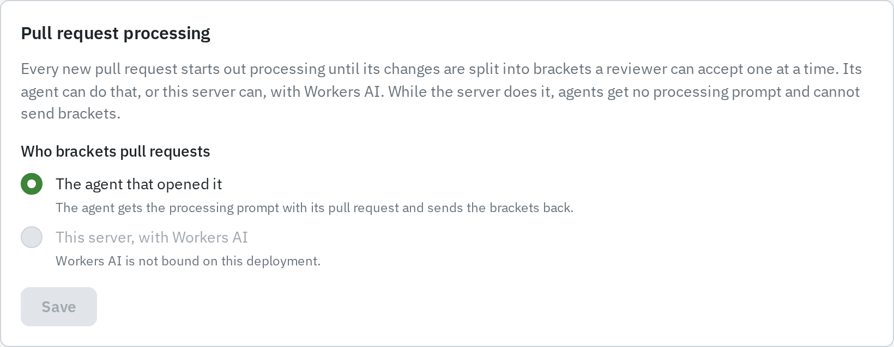
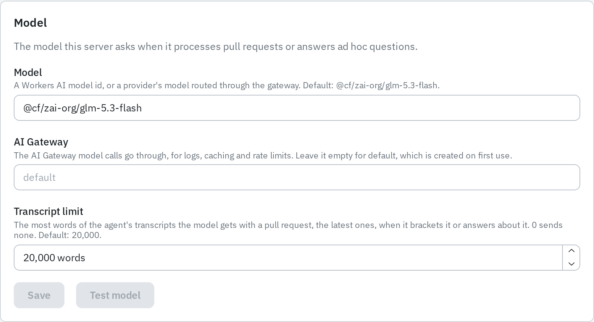
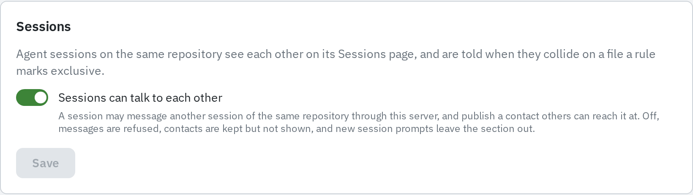
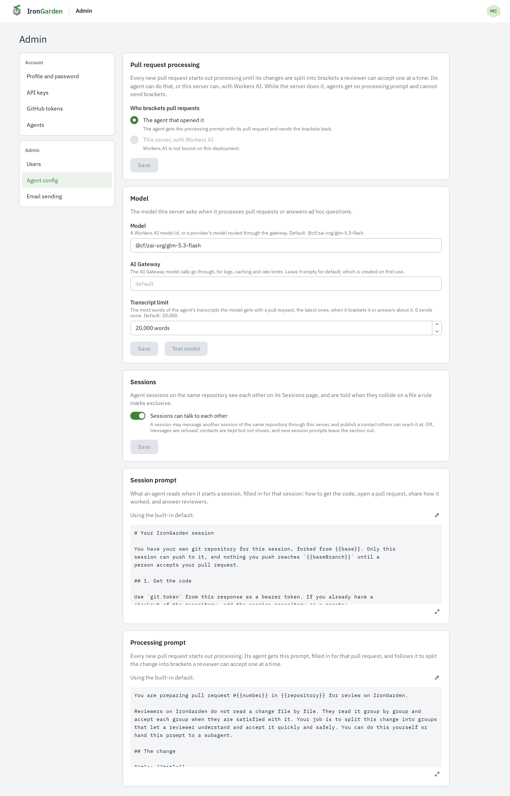

Every new pull request starts out processing until its changes are split into
[brackets](/code-review/brackets/) a reviewer accepts one at a time. By default the agent
that opened it does this. An instance admin can have the server do it instead, with
Workers AI, under **Admin › Agent config**.

The same page holds the model the server uses, the sessions switch, and the two agent
prompts. The prompts have their own page: [Prompt customization](/administration/prompt-customization/).

## Processing mode

The **Pull request processing** card has one choice, **Who brackets pull requests**:

- **The agent that opened it.** The agent gets the processing prompt with its pull request
  and sends the brackets back. This is the default.
- **This server, with Workers AI.** A queued job asks the model below, in a sandbox that can
  read only that pull request. Agents get no processing prompt and cannot send brackets.

Select **Save** to apply it. Each revision records the mode when it is stored. The
choice applies to revisions stored after you save.

While the server processes pull requests:

- people with Write on a GitHub-connected repository can
  [open a pull request from GitHub](/capabilities/github-integration/#opening-a-pull-request-from-github);
- the pull request chat offers **Ad hoc**, which the server answers (see below).

If the server cannot process a revision, the pull request opens without brackets and says
why. Refreshing the pull request tries again. See
[Pull request processing](/agent-workflows/pull-request-processing/).

## What the server needs

Server-side processing needs three Cloudflare bindings: Workers AI, a Worker Loader (each
job's model step runs in a sandboxed Worker), and the `PROCESSING` Durable Object. Every
deploy binds all three, and none needs creating. Agents keep bracketing until an admin
switches to the server.

If a binding is missing, the server option is disabled with **Workers AI is not bound on
this deployment**, and pull requests fall back to their agents. Local development is the
usual case: Workers AI has no local simulator. See
[development.md](https://github.com/alonbardavid/iron-garden/blob/main/docs/development.md)
to bind the real service locally.

Model calls always go through an [AI Gateway](https://developers.cloudflare.com/ai-gateway/).
Unless you name one, the gateway called `default` is used. AI Gateway creates it on first use.

## Choosing a model

The **Model** card sets the model the server asks when it processes pull requests or answers
ad hoc questions.

| Field                | Meaning                                                                                                        | Default                     |
| -------------------- | -------------------------------------------------------------------------------------------------------------- | --------------------------- |
| **Model**            | A Workers AI model id, or a provider's model routed through the gateway.                                       | `@cf/zai-org/glm-5.3-flash` |
| **AI Gateway**       | The gateway model calls go through. Leave it empty for `default`.                                              | `default`                   |
| **Transcript limit** | The most words of the agent's transcripts the model gets with a pull request, the latest ones. `0` sends none. | 20,000 words                |

As you type in **Model**, it suggests matching models: text-generation models from the
Workers AI catalogue whose names contain every word you typed, and Anthropic's Claude
models. You can also type any other id.

### Claude models

Claude models (ids starting `anthropic/`, such as `anthropic/claude-sonnet-5.5`) run on
Anthropic, routed there by AI Gateway through the same Workers AI binding. They are billed
through AI Gateway, in one of two ways:

- AI Gateway's Unified Billing credits, or
- an Anthropic API key stored on the gateway named in **AI Gateway**.

Set either up on the gateway in the Cloudflare dashboard. %PRODUCT_NAME% holds no Anthropic
key itself.

### Test model

**Test model** asks the model and gateway in the form, saved or not, for a one-line answer.
The card then shows whether it answered and how long it took, or why it failed, with when
and through which gateway it was tested. Test before you save a new model.

## Ad hoc questions

While the server processes pull requests, the chat on every pull request offers **Ad hoc**
beside a person's own agents. It is the only choice when none of their agents is listening.
Anyone who can read the pull request can use it.

The server answers with the change, its brackets, its transcripts (up to the transcript
limit), the person's thread so far and what they were looking at. The model can read more
files of the repository first. See [Agent chat](/code-review/agent-chat/).

## Session settings

The **Sessions** card has one switch, **Sessions can talk to each other**, on by default.
Agent sessions on the same repository always see each other on its Sessions page, and are
told when they collide on a file a rule marks exclusive.

With the switch on, a session may message another active session of the same repository
through the server, and publish a contact others can reach it at. Turned off:

- messages are refused;
- contacts are kept but not shown;
- new session prompts leave out the messaging section.

Chat between a person and their own agent's session is not affected. See
[Managing agents and sessions](/agent-workflows/agents-and-sessions/).

## Prompts

The last two cards on the page are the **Session prompt** and the **Processing prompt**.
Both have built-in defaults; editing them is covered in
[Prompt customization](/administration/prompt-customization/).

