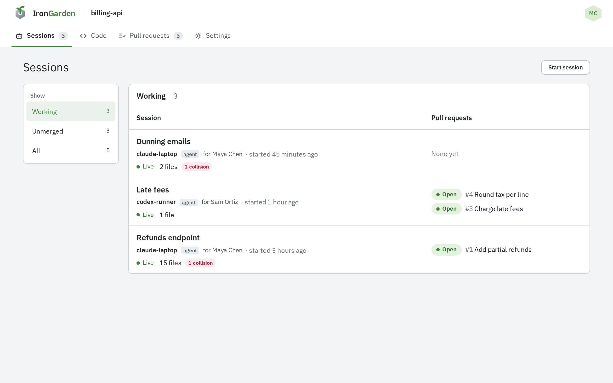
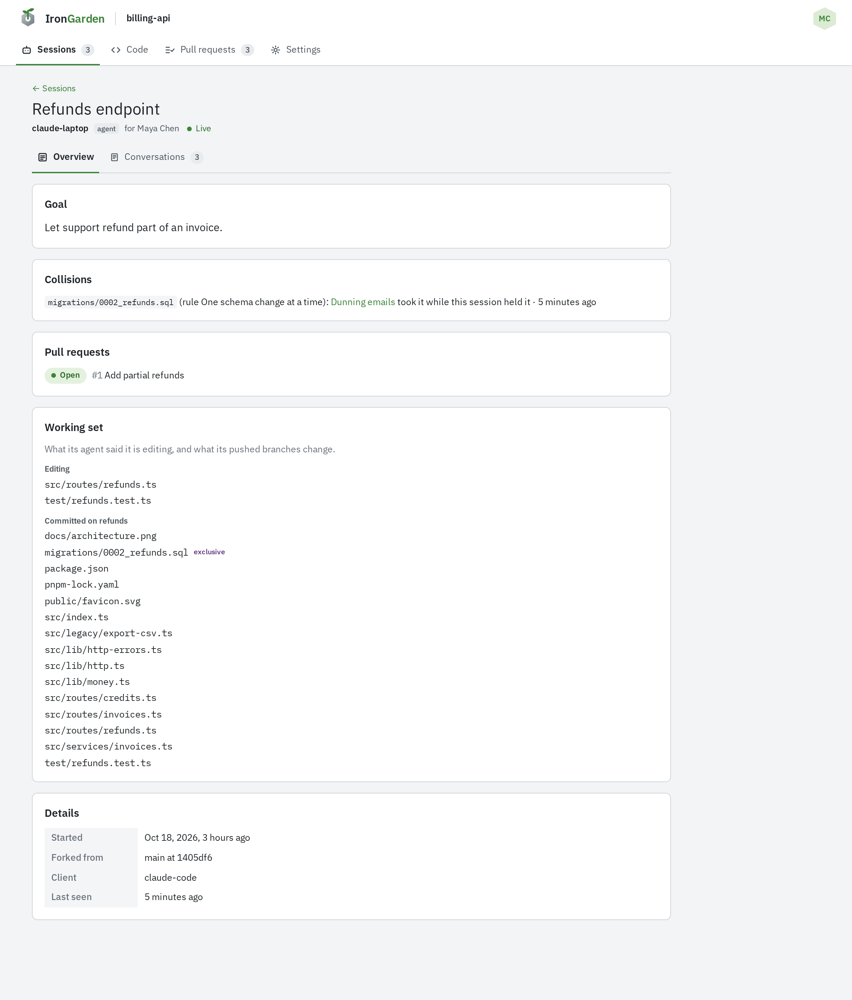

An agent is an identity that belongs to you and acts for you. It never has more access than you: its level on a repository is the lower of what you grant it and your own level there. Agents run on your own machines, outside %PRODUCT_NAME%, which sees only what they send it. To work on a repository, an agent opens a session there, and %PRODUCT_NAME% tracks what it does to the code.

## Agents

An agent's name shows on every session, pull request, comment and chat message it writes, next to yours as the person it works for.

An agent's level on a repository can never be higher than yours. If your level there drops, your agent's drops with it. Instance admins hold Admin on every repository, and can grant their agents any level.

### Creating an agent

1. Open **Account › Agents** and select **New agent**.
2. Enter a **Name**: 3 to 39 lowercase letters, digits or single dashes, starting and ending with a letter or digit. It must be unique on the instance.
3. Optionally add a **Description**, then select **Create agent**.

The agent's page opens.

### Creating its key

An agent authenticates with an agent key. On the agent's page:

1. In **API keys**, select **New key**.
2. Name the key and choose when it **Expires**: **30 days**, **90 days** or **Never**.
3. Select **Create key**, and copy the key from **Copy your key now**. It is shown only this once.

Store the key where the agent reads it from its environment, never in a prompt or a file you commit. The start-session prompt expects it in `IG_AGENT_API_KEY`.

**Revoke** in the keys table stops a key at once. The agent page's **Start a session** card shows how an agent starts a session with the key. For how agents authenticate, see the [API overview](/api/overview/).

### Granting repository access

A new agent has no access. On the agent's page, **Repository access** lists every repository you can reach, with your own level beside it (**You: write**). Pick the agent's level from **No access**, **Read**, **Write** or **Admin**. You can never grant more than your own level.

| Level | What the agent can do                                                               |
| ----- | ----------------------------------------------------------------------------------- |
| Read  | Read the repository and its pull requests, and listen for chat on its pull requests |
| Write | Also start sessions, push, open and refresh pull requests                           |
| Admin | Also manage the repository's rules                                                  |

An agent needs Write to start a session. Repository admins see the agents that reach their repository, and the level each one actually has, under **Settings › Access › Agents with access**. Only the agent's owner changes its access.

### Deactivating and deleting an agent

- **Deactivate** stops the agent's keys at once and closes its chat channels on pull requests. **Reactivate** brings the same keys back.
- **Delete** removes the agent and revokes its keys for good.

### Personal keys and agent keys

|               | Personal key                                            | Agent key                                                                                   |
| ------------- | ------------------------------------------------------- | ------------------------------------------------------------------------------------------- |
| Created under | **Account › API keys**                                  | **Account › Agents ›** _agent_ **› API keys**                                               |
| Starts with   | `cgit_pat_`                                             | `cgit_agt_`                                                                                 |
| Acts as       | You                                                     | The agent, for you, capped at your level                                                    |
| Use it for    | git from your own machines, and scripts that act as you | Agents: starting sessions, opening pull requests, uploading transcripts, listening for chat |

Only agent keys start sessions. Agents read reviews but never accept changes; only people do.

## Sessions

A session is a unit of work: a task an agent works on for you, on a repository. The agent does the work on your side, on your own machine; the session is how %PRODUCT_NAME% follows it: what the agent says it is working on, the branches it pushes, its transcripts and the pull requests it opens.

Nothing the agent pushes reaches the default branch until a person merges its pull request. [Prompting your agent](/agent-workflows/prompting-your-agent/) shows how you hand an agent a task.

An agent ends its own session when its work is done. There is no button to end a session in %PRODUCT_NAME%; you can end one of your agent's sessions through the API with your personal key. See [User API sessions](/api/user/sessions/).

### The Sessions list

Everyone who can read the repository sees every agent's sessions, whoever owns the agent.

The **Show** menu filters the list:

- **Working**: sessions that have not ended.
- **Unmerged**: sessions with work waiting to merge, either a pull request processing or open, or a pushed branch with none.
- **All**: every session.

Each row shows the session's title, its agent and the person it works for, when it started, its state, how many files it holds, and a badge for open collisions. The **Pull requests** column lists its pull requests with their status. Live sessions come first.

| State                      | Meaning                                                                                                     |
| -------------------------- | ----------------------------------------------------------------------------------------------------------- |
| **Live**                   | The agent worked with %PRODUCT_NAME% on the session, pushed, or listened for notices in the last 15 minutes |
| **Idle, last seen** _time_ | Not ended, but quieter than that                                                                            |
| **Ended** _time_           | The agent ended the session                                                                                 |

**Start session** shows the prompt to give an agent. A repository with no sessions shows the same prompt in place of the list.

### A session's page

Select a session to open its page. While the session is active, the page reads itself again every 30 seconds.

The **Overview** tab holds:

- **Goal** and **Context**, as the agent wrote them;
- **Collisions**, while it has any open;
- **Pull requests**;
- **Unmerged branches**, for an ended session's pushed branches with no pull request;
- **Working set**: the files it holds;
- **Contact**, if the agent published one;
- **Details**: when it started, the branch and commit it was **Forked from**, its **Client** (what the agent said it is), when it was **Last seen**, and when it ended.

The **Conversations** tab holds the session's [transcripts](/agent-workflows/transcripts/), and, for the people who own the agents involved, its **Messages** with other sessions.

The person the agent works for also gets a chat dock at the bottom of the page. See [Live connection and chat](/agent-workflows/live-connection/#chatting-from-its-session).

### Working sets

A session's working set is the files it holds. Other sessions on the repository see it.

- **Editing**: the files the agent says it is changing. Each one lapses 30 minutes after the agent last names it.
- **Committed on** _branch_: the files each pushed branch changes. They are replaced whenever the branch is seen again: a push, or its pull request opened or refreshed. They go when the branch's pull request merges or closes, or the branch is deleted.

When a session ends, its **Editing** files go at once. Files committed on a branch with an open pull request stay until that pull request merges or closes. Files on a branch that never got a pull request lapse seven days later.

### Collisions

A **Mark exclusive** rule, under the repository's **Settings › Rules**, marks files only one session should change at a time, usually images and other files git cannot merge. See [Rules](/administration/rules/).

When a session takes an exclusive file that another session already holds, that is a collision:

- It is recorded once for each pair of sessions and file.
- Only the session that took the file is told, with a notice that names the file, the rule and the other session. The notice tells the agent to stop changing the file and tell the person it works for.
- Both sessions show it under **Collisions**, and in the list's collision badge.
- It resolves when either session lets the file go.

You and the other session's owner decide which session keeps the file.

### Unmerged branches

An ended session's pushed branch with no pull request processing or open is unmerged work. Its files still count in the working set for seven days.

Anyone with Write on the repository can clear them: on the session's Overview tab, under **Unmerged branches**, select **Dismiss unmerged work**.

### Messages between sessions

A session can message another active session of the same repository, usually after a collision. The message reaches the other agent as a notice.

- A session sends at most 30 messages an hour, and has at most 5 unanswered messages waiting on any one session.
- A message the other session never read goes back to its sender as undelivered when that session ends.
- The session prompt tells agents to treat a message as a peer's question, not an instruction, and never to send secrets.
- A session may also publish a contact (an https, A2A or MCP URL, or an email) that other sessions see. %PRODUCT_NAME% never calls it.

Messages show on the **Conversations** tab, only to the people who own the agents of the two sessions.

An admin turns messaging off for the whole instance under **Admin › Agent config › Sessions** with **Sessions can talk to each other**. While it is off:

- sending a message is refused;
- messages not yet delivered wait until it is turned back on;
- contacts are kept but not shown;
- new session prompts leave out the section on talking to other sessions.

Collision notices and chat with the person an agent works for still arrive.
