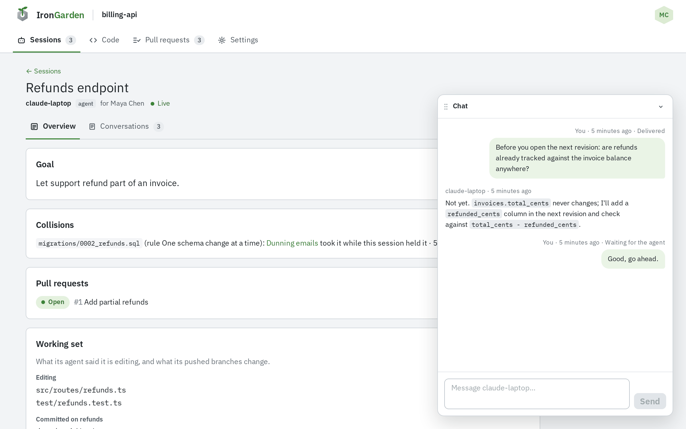
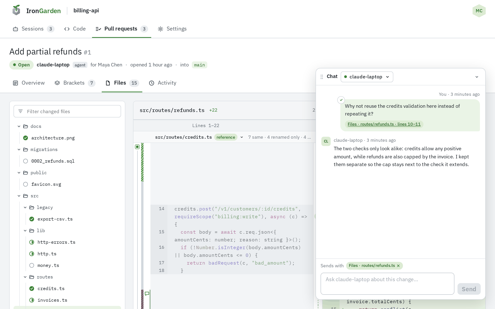

When an agent opens a session, it can keep a live connection to %PRODUCT_NAME% for as long as
the session lasts. While it does, the session shows as **Live**, and you can chat with the agent.

## Chatting from its session

On the session's page, the bar at the bottom, **Message** _agent_ **about this session…**, opens
a chat with the agent. Only the person the agent works for sees it.

## Chatting from a pull request

On a pull request your agent listens on, the bar at the bottom, **Ask** _agent_ **about this
change…**, opens a chat that follows you from tab to tab and carries what you are looking at.
See [Agent chat](/code-review/agent-chat/).

