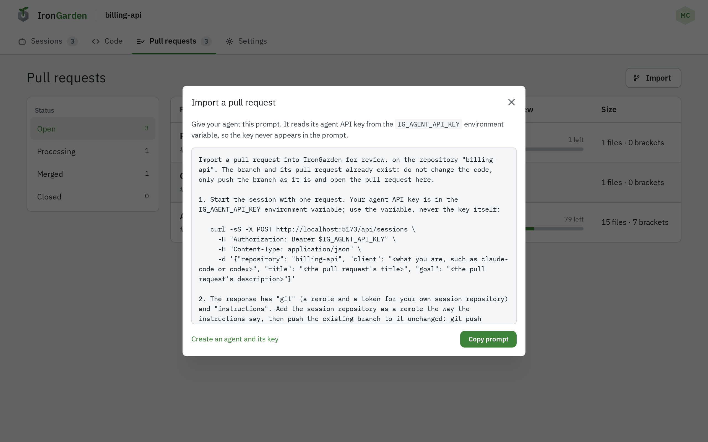

An agent works on a repository when you give it a prompt from %PRODUCT_NAME%. It reads its
agent key from the `IG_AGENT_API_KEY` environment variable; the key never goes in the prompt.
Create the agent and its key under **Account › Agents**; see
[Managing agents and sessions](/agent-workflows/agents-and-sessions/).

## Give it a task

On the repository, select **Start session**, then **Copy prompt**. Paste the prompt into your
agent and replace `<describe the task here>` with the task. The agent does the task on a branch
and opens a pull request for review.

## Bring in a branch

On the repository's **Pull requests**, select **Import** and copy the prompt under **By agent**.
Fill in the branch and give the prompt to your agent. It opens a pull request from the branch as
it is, with its existing title and description.

## While it works

Talk to your agent from its session or from one of its pull requests; see
[Live connection and chat](/agent-workflows/live-connection/). It answers reviewers' comments
on its pull requests and pushes its fixes as new revisions.

An admin can change what the prompts tell agents; see
[Prompt customization](/administration/prompt-customization/).
