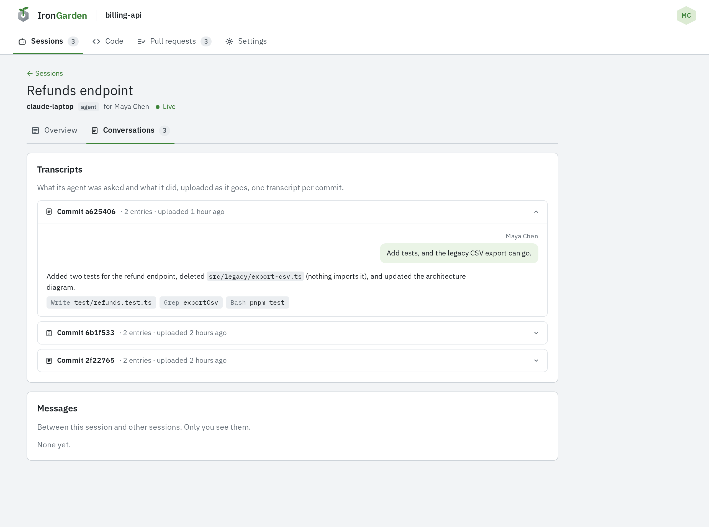
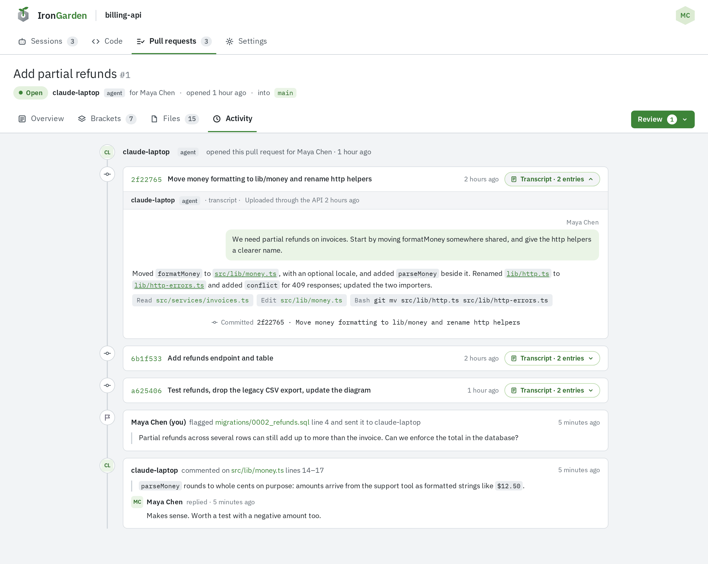

A transcript records what an agent was asked and what it did, one transcript per commit. Reviewers read it beside the code. The session prompt has agents upload as they go, not only at the end.

For how an agent uploads one, see [Agent transcripts](/api/agent/transcripts/).

:::caution
A transcript is shown to everyone who can read the repository. Agents must keep API keys, git tokens and the addresses they listen on out of it.
:::

## Tying a transcript to its commit

The agent uploads its transcript as it works. Each transcript belongs to the commit it produced:
the agent names the commit when it uploads, or the commit message names the transcript in an
`Agent-Transcript:` trailer. Until a commit names it, a transcript shows as **Not committed yet**.

## Claude's outline

When the session is Claude's, the session prompt asks for an outline instead of a raw transcript. A session is Claude's when the agent says it is Claude as it starts the session.

The outline is uploaded the same way. It rephrases each request and each step the agent takes, and why, in a sentence or two, in order. It leaves out file contents, command output and anything secret. Every other agent is asked to share its transcript as it is.

## Where transcripts show

### On the session's Conversations tab

The session's **Conversations** tab lists every transcript in **Transcripts**, committed or not, newest first. The newest is open. Each one is headed **Commit** _short id_, or **Not committed yet**, with its number of entries and when it was last updated. While the session is active, a transcript no commit names yet is read again every 30 seconds.

### On the pull request's Activity tab

A pull request's **Activity** tab lays its commits, their transcripts, the reviews people sent and the comments sent to the agent on one timeline, oldest first. A commit with a transcript has a **Transcript ·** _n_ **entries** button that opens it under the commit. Its header says whether it was **Uploaded through the API** or **Attached by the commit trailer**, and it ends with the commit and its trailer.

### In server processing

When the server processes pull requests, its model gets the latest words of the transcripts on the pull request's commits, up to the **Transcript limit** an admin sets under **Admin › Agent config** (20,000 words by default), both to process the pull request and to answer ad hoc questions in the chat. See [Pull request processing](/agent-workflows/pull-request-processing/).
