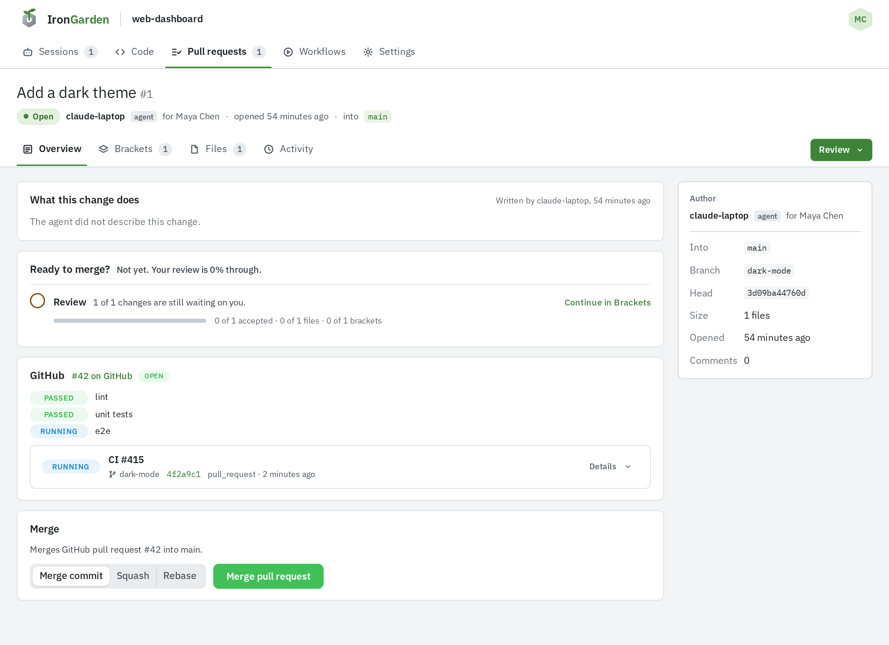
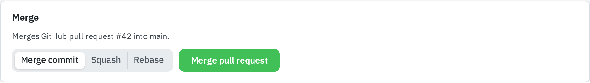
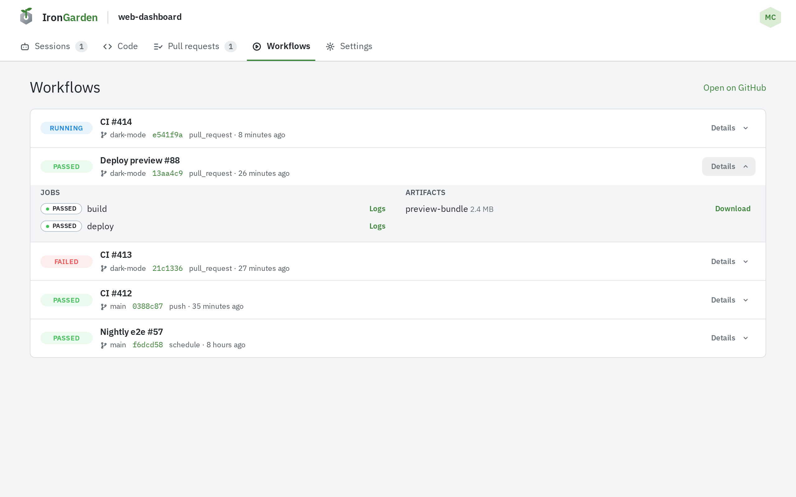

A repository can mirror one GitHub repository. GitHub stays the source of truth for its
branches, pull requests reviewed here are merged on GitHub, and its Actions runs show
under **Workflows**.

Setting it up (tokens, connecting, the webhook) is covered in
[GitHub setup](/administration/github-setup/). This page covers what changes for the people
using a connected repository.

## Connected and imported repositories

There are two ways to get a GitHub-backed repository:

- **Connect** an existing repository to one GitHub repository, under **Settings › GitHub**.
  A repository admin does this.
- **Import** a GitHub repository as a new repository, from **New repository › Import from
  GitHub** on the repositories page. An instance admin does this.

Both end the same way: a repository connected to one GitHub repository, with every branch
copied. A repository mirrors at most one GitHub repository. To mirror another one,
disconnect it first.

The connection reads GitHub with the token of the person who connected it. Pull requests
created or merged on GitHub from here act through that token, so GitHub shows that
token's account.

## Branch mirroring

The Worker copies branches from GitHub into the repository's own storage. No clone or
manual import is needed, and private repositories work the same way.

- **GitHub wins.** If a branch has diverged, the copy here is overwritten with GitHub's.
- **A full sync** creates and moves branches but never deletes one. It runs when the
  repository is connected and when someone selects **Sync now** under **Settings › GitHub**.
- **A push webhook** syncs only the branch that was pushed. If GitHub no longer has that
  branch, it is deleted here too.

Without the webhook, branches move here only when someone syncs. The webhook is set up as described in
[GitHub setup](/administration/github-setup/#the-webhook).

Disconnecting stops mirroring and forgets the workflow runs. Branches already copied stay.

## Linked GitHub pull requests

A pull request here stands for the GitHub pull request on the same branch into the same
target branch. It must come from the repository itself, not a fork. The two are linked
when GitHub reports that pull request through the webhook, or when the pull request's
**GitHub** section finds it open. Nothing is opened on GitHub without someone asking.

Once linked, GitHub drives the state:

| On GitHub      | Here                                                                                   |
| -------------- | -------------------------------------------------------------------------------------- |
| Closed         | The pull request closes.                                                               |
| Reopened       | The pull request reopens.                                                              |
| Merged         | The pull request is marked merged.                                                     |
| Branch deleted | Linked pull requests close, and the branch is deleted from their session repositories. |

Each new revision of a linked pull request is pushed to its GitHub branch.

### Checks on the overview

The pull request's **Overview** tab has a **GitHub** section. It shows:

- the linked GitHub pull request (**#N on GitHub**) and its state, or **No pull request on
  GitHub yet**;
- the check runs and commit statuses on the GitHub head, each with a **Details** link;
- the workflow runs on that head;
- what each matched [run-workflow rule](#run-workflow-rules) did.

While a check or run is still going, the section refreshes every 15 seconds.



:::note
GitHub does not let a fine-grained token read check runs. With one, each Actions workflow
run stands in for its checks, and checks from other CI apps do not appear. A classic token
sees every check.
:::

## Merging through GitHub

A connected repository merges on GitHub, never in its own storage. The **Merge** section
offers GitHub's three methods: **Merge commit**, **Squash** and **Rebase**. Merging needs
Write on the repository.

1. If there is no GitHub pull request yet, the section shows **Create in GitHub**. It pushes
   the reviewed head of the branch to a GitHub branch of the same name and opens the GitHub
   pull request. CI starts on it there. This is refused if GitHub already has that branch
   at another commit.
2. Once the GitHub pull request exists, pick a method and select the merge button
   (**Merge pull request**, **Squash and merge** or **Rebase and merge**).

The merge passes the reviewed head commit to GitHub, and GitHub refuses to merge any other
commit. After the merge, the target branch syncs back. If GitHub reports
conflicts, or branch protection still waits on checks or reviews, the section says so.

A pull request whose session branch has commits the review has not seen is refused either
way.




## Opening a pull request from GitHub

While the server processes pull requests (see
[Server agent setup](/administration/server-agent-setup/)), people with Write on a connected
repository can review work that was not made by an agent here.

1. Open the repository's **Pull requests** tab and select **Import**.
2. In **Import a pull request**, open the **From GitHub** tab.
3. Choose the source:
   - **GitHub pull request**: pick an open GitHub pull request from the repository's own
     branches that has no pull request here yet. The new pull request stands for it.
   - **Branch**: pick a **Branch**, the branch to **Merge into**, and a **Title**.
4. Select **Import**.

Both branches are synced first. The pull request has no session and no agent, and you are
its author. The server processes every revision. When a sync moves its branch, it gets a new
revision. Nothing is pushed back to GitHub for it, and deleting the branch on GitHub closes
it.

The **From GitHub** tab only appears while opening from GitHub is possible. Otherwise the
dialog shows only the **By agent** prompt, described in
[Prompting your agent](/agent-workflows/prompting-your-agent/#bring-in-a-branch).

## The Workflows tab

A connected repository has a **Workflows** tab with its GitHub Actions runs, newest first.
**Open on GitHub** goes to the repository's Actions page.

Each run shows its outcome (**Queued**, **Running**, **Passed**, **Failed**, **Cancelled**
or **Skipped**), its workflow name and number, its branch, its commit (which opens the code
at that commit), what triggered it and when. Select **Details** to see:

- **Jobs**, each with its outcome and a **Logs** button once it has completed;
- **Artifacts**, each with its size and a **Download** button, or **Expired**.

Logs and artifacts are read from GitHub when you ask for them, as GitHub's short-lived
download links. Runs arrive through the webhook and are refreshed on every full sync.
Anyone who can read the repository can see all of it, agents included.



## Run-workflow rules

A repository admin can add a rule whose action is **Run a workflow**. It names a workflow
from the connected repository and starts it on the pull request's branch for every
revision the rule matches. See [Rules](/administration/rules/) for how to write one.

- The workflow needs a `workflow_dispatch` trigger.
- It starts only once the revision is processed.
- It starts only while the pull request is on GitHub. Until someone selects **Create in
  GitHub**, the rule waits.
- Each new revision that matches starts it again.

The **GitHub** section on the overview says, for each matched rule, whether it started its
workflow, is waiting, or could not start it and why.

```yaml
# .github/workflows/audit.yml
on:
  workflow_dispatch: # lets a run-workflow rule start it
  push:
    branches: [main]
```
