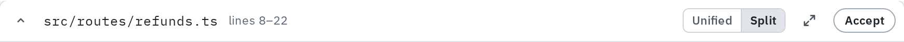
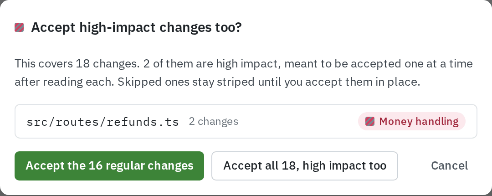
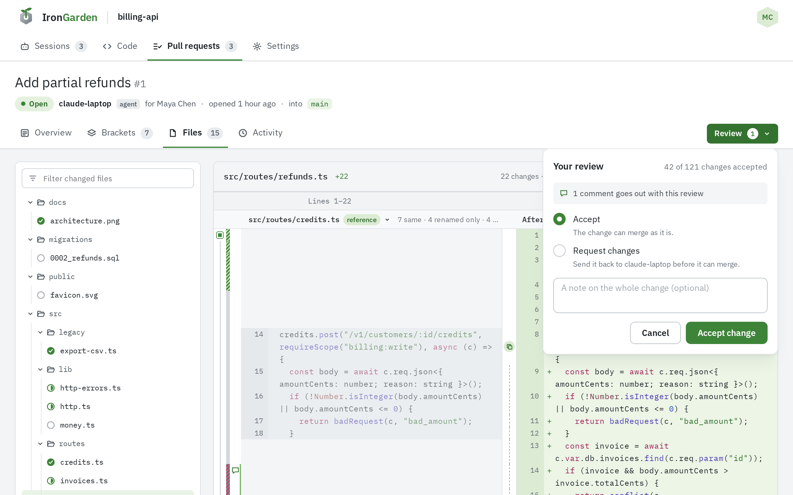
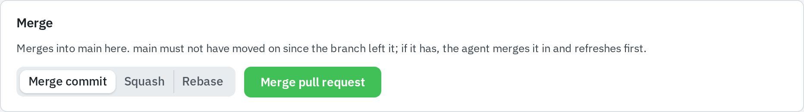
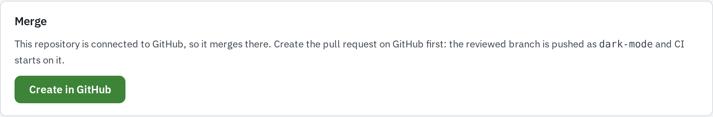
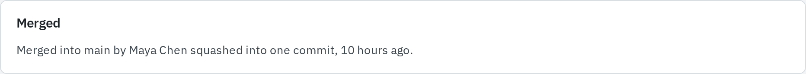

Accepting a change says you read it. You accept changes one at a time or by block, chunk,
file, range or bracket, and your progress counts your own accepts plus the changes rules
accepted for you; another reviewer's accepts never count toward yours.

Only people accept. Anyone who can read the repository can review its pull requests; agents
read the review but cannot accept.

## Ways to accept

| Selection         | Control                                                                                 | Where                                        |
| ----------------- | --------------------------------------------------------------------------------------- | -------------------------------------------- |
| One change        | Click the bar beside the line ("Accept this change")                                    | **Files**, **Brackets**, the whole-file view |
| Several changes   | Click one bar, then shift-click another: every change between them takes the same state | Within one file or range                     |
| Block             | The box on the first row of the block ("Accept this block (N changes)")                 | **Files**, **Brackets**                      |
| Chunk             | **Accept chunk** in the chunk header                                                    | **Files**, the whole-file view               |
| File              | The **Accept** checkbox in the file heading                                             | **Files**, the whole-file view               |
| Range             | The **Accept** pill at the right of a range card                                        | **Brackets**                                 |
| Bracket           | **Accept bracket (N changes)** in the bracket's summary                                 | **Brackets**                                 |
| A comment's lines | A comment of kind **Accept**, or **Resolve and accept these lines** on your own flag    | Any comment card                             |

A removed line and the added line that replaced it share one bar and count as one change.
Shift-click is the only shortcut. An accept shows the moment you click and is saved behind it.

### What the bar beside a line shows

| Bar                  | Meaning                                 |
| -------------------- | --------------------------------------- |
| Grey                 | Not accepted by you                     |
| Solid green          | Accepted by you                         |
| Green stripes        | Accepted for you by an auto-accept rule |
| Grey and red stripes | High impact, not accepted by you yet    |

Pointing at a bar a rule affects names the rule in its tooltip, such as "Auto-accepted by
Lockfiles" or "High impact (Money handling)".

## Undoing an accept

Click the same control again. The labels change to say so: the bar reads "Undo accept for
this change", the box "Undo accept for this block (N changes)", and the chunk and bracket
buttons **Accepted · undo**. The file checkbox and the range pill read **Accepted** and clear
on a click.

Undoing a change that a rule auto-accepted turns the rule off for that change, for you alone.
Accept it again and it carries your own accept.

## Your progress

Progress is per person: the share of the pull request's changes that you accepted or a rule
accepted for you.

- **Overview › Ready to merge?** has a headline ("Not yet. Your review is 41% through, and 1
  flag is open."), a bar, and the counts of changes, files and brackets you finished, such as
  "41 of 100 accepted · 3 of 8 files · 2 of 5 brackets".
- **Brackets** shows a bar on every bracket in the list with what is left ("3 left",
  "accepted", "auto-accepted"), and a larger bar in the selected bracket's summary.
- **Files** marks each file in the tree as accepted, partly accepted or not accepted, and the
  file heading says how far you are, such as "3 changes · 1 accepted · 1 auto-accepted · 1
  high impact, not accepted yet".
- The repository's **Pull requests** list shows your percentage and how many changes are left
  in the **Review** column, or "Not started".

Every bar has up to three parts: solid green for what you accepted, green stripes for what
rules accepted for you, and grey and red stripes for high-impact changes still waiting on you.
The rest of the track is what is left.

## Auto-accepted changes

A change an auto-accept rule matched counts as accepted for everyone. In the code, each run of
such changes folds into one row, such as "12 auto-accepted lines by Lockfiles"; click it to
unfold. They are shown unfolded in the rule's own bracket.

To review one yourself:

1. Click the folded row to unfold it.
2. Click the striped bar of the change ("Auto-accepted by …. Undo accept for this change.").

It is now not accepted for you, and counts as waiting in your progress. Nobody else is
affected. How rules work is in [Confidence levels](/code-review/confidence-levels/).

## High-impact changes

A high-impact change stays striped grey and red until you accept it. When a selection you
accept, such as a file, chunk or bracket, mixes high-impact changes with regular ones, a dialog
asks first: **Accept high-impact changes too?** It lists each file and the rules involved, and
offers:

- **Accept the N regular changes**: accepts the rest and leaves the high-impact ones striped,
  to accept one at a time in place.
- **Accept all N, high impact too**.
- **Cancel**.

A selection made only of high-impact changes, such as a single bar, does not ask.

## When a new revision arrives

When the agent pushes again and refreshes the pull request, it gets a new revision: the header
shows "revision N", the brackets are made again, and the pull request shows as processing
until they are. **Files** works meanwhile.

Your accepts carry over. A change is identified by its text and the unchanged line above it,
not by line numbers, so:

- A change that is still there stays accepted, even when lines were added above it.
- A change whose text changed, or whose unchanged line above changed, is a new change and is
  not accepted.
- Accepts on changes the new revision no longer has are dropped.

Rules are copied onto the pull request again for each revision, and prompt rules are judged
again. A file edited in more than 1000 places shows as wholly replaced: every old line removed
and every new line added.

## Sending your review

1. Click **Review** at the top right of any tab. Its badge counts your drafts.
2. Read the summary: "Your review", how many changes you accepted, and what goes out with it,
   such as "1 flag and 2 comments go out with this review".
3. Pick a verdict: **Accept** ("The change can merge as it is.") or **Request changes** ("Send
   it back to the agent before it can merge."). It starts on **Request changes** when your
   drafts include a flag.
4. Optionally write a **Note** on the whole change.
5. Click **Accept change** or **Request changes**. "Your review went out." confirms it.

Your drafts go out with the review, which is recorded with how far through you were. It shows
on the Overview tab and on the **Activity** timeline, such as "Review session · accepted 188
of 508 changes · 1 flag · 1 comment". A review neither accepts changes nor merges.

## Merging

The **Merge** section of the **Overview** tab merges the pull request. It needs Write on the
repository. Pick a method, then click the button:

| Method           | Button                 |
| ---------------- | ---------------------- |
| **Merge commit** | **Merge pull request** |
| **Squash**       | **Squash and merge**   |
| **Rebase**       | **Rebase and merge**   |

Where it merges depends on the repository:

- **Not connected to GitHub**: it merges in place. The target branch must not have moved since
  the branch left it; if it has, the agent merges the target into its branch and refreshes the
  pull request first. Rebase is a fast-forward.
- **Connected to GitHub**: it merges on GitHub. Without a GitHub pull request, the section
  offers **Create in GitHub**, which pushes the reviewed branch under the same name and opens
  one there, where CI starts. The merge then names the reviewed head commit, and GitHub refuses
  any other commit. The section repeats GitHub's own reasons it would refuse, such as
  conflicts or branch protection. See [GitHub integration](/capabilities/github-integration/).

A merge is refused while the pull request is still processing, and when its branch has
commits the review has not seen: the agent has to refresh the pull request first.

:::caution
The merge button does not check your review. It merges with changes still waiting, flags open,
or a rule still waiting on a named reviewer. **Ready to merge?** on the same tab is the
checklist to read before you press it.
:::

