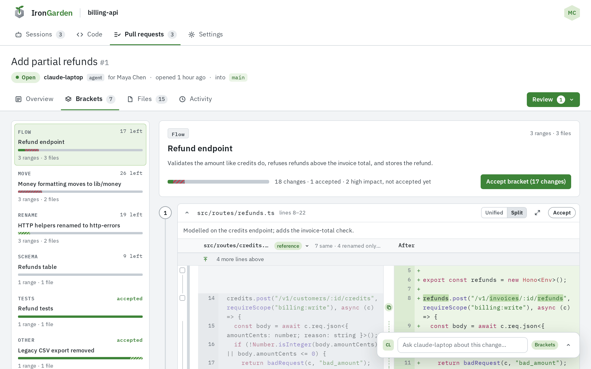
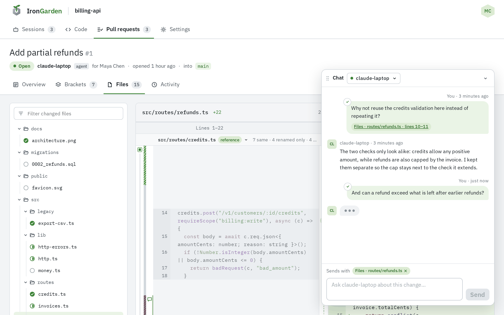
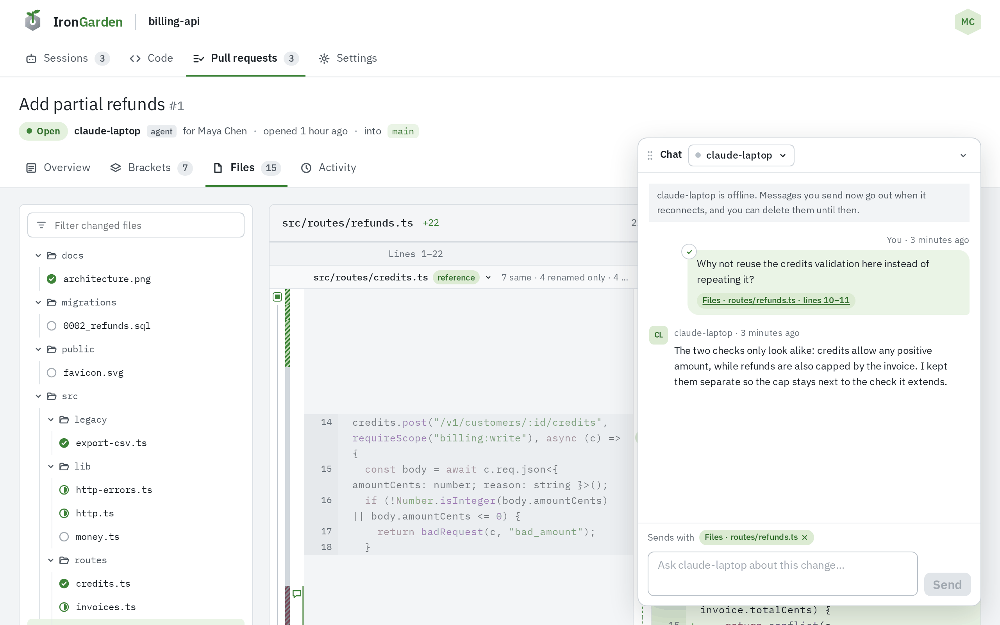

The chat lets you ask your own agent about a pull request while you review it. Each message
carries what you were looking at, such as the file and lines.
Nobody else sees your chat, and you never see or write to someone else's agent.

This page is the reviewer's side. How an agent listens and answers is in
[Live connection and chat](/agent-workflows/live-connection/).

## Opening the chat

A bar sits at the bottom right of every tab of a pull request, reading "Ask claude-laptop about this
change…", with a chip of what a message would carry. Click it to open the **Chat** panel. Drag
the panel by its header to move it anywhere; collapse it back to the bar from its header.

The bar shows only when one of your agents has a chat on the pull request, or when the server
answers ad hoc questions. The agent that opened the pull request gets its chat when it opens
it, for as long as its session lasts; another of your agents joins by listening on the pull
request itself.

## Picking your agent

The agent picker in the panel's header (**Who to talk to: …**) lists your agents listening on
the pull request. Each shows a green dot when live and a line such as "Made this change · live",
"Your agent · offline since 5 minutes ago" or "not connected yet". The last option is **Ad hoc**.

Unless you pick one, the chat opens on a live agent of yours, else the one that made the
change, else any of yours, else **Ad hoc**. Each agent has its own thread: switching agents
switches threads.

## What a message carries

Above the message box, **Sends with** shows what goes along:

- **The tab**: Overview, Brackets, Files or Activity.
- **The bracket** open on the **Brackets** tab, or **the file** open on the **Files** tab.
- **The lines** of a comment you are writing on **Files** or **Brackets**, such as
  "Files · routes/invoices.ts · line 20".
- **Your selection**: text you selected anywhere on the page outside the chat, up to 10,000
  characters.

Click the **×** on a chip to send without it; looking at something else brings the context
back. Your selection goes to the agent but never shows in the thread. The file, lines or bracket
a message was about show as a chip under it that links back there.

Enter sends; Shift+Enter starts a new line.

## Asking about lines

Whenever the chat is offered, a comment of kind **Ask** goes to the chat instead of onto
the lines. Its hint says "A question, sent to claude-laptop in the chat; it leaves no comment." (with your agent's name):

1. Start a comment on the lines with the **+** in the note column.
2. Write the question.
3. Pick **Ask** from **Kind of comment**, then click **Ask**.

The question goes into your thread with the lines as context, and the chat opens. When the chat
is not offered, an ask is a comment marked **Question** that the agent reads with the other comments.

## Delivery, thinking dots and deleting

A tick on the corner of each of your messages says where it is: a spinner while sending, a clock
while the agent is offline ("claude-laptop is offline; it gets this when it reconnects"), a check once
it has it ("claude-laptop received this").

While the agent is offline, the panel says so, and your messages go out when it reconnects.
Until the agent has a message, you can take it back with the bin icon (**Delete this
message**). A message it already has cannot be deleted.

When the agent says it is working on your message, three dots show under the thread until it
answers, or for five minutes at most.

Answers are markdown. An answer can show lines of the change, which render as those lines of
the diff with a link to the file.

## Ad hoc questions

While the server processes pull requests, **Ad hoc** is offered beside your agents to anyone who
can read the pull request, and it is the only choice when none of your agents listens. The
server's model answers: it has the change, its brackets, the agent's transcripts, your thread so
far and what you were looking at, and it can read the repository's files first. Each person has
their own ad hoc thread.

When the server does not process pull requests, **Ad hoc** shows greyed out, "Agents are not
enabled on this server". An admin turns server processing on; see
[Server agent setup](/administration/server-agent-setup/).
