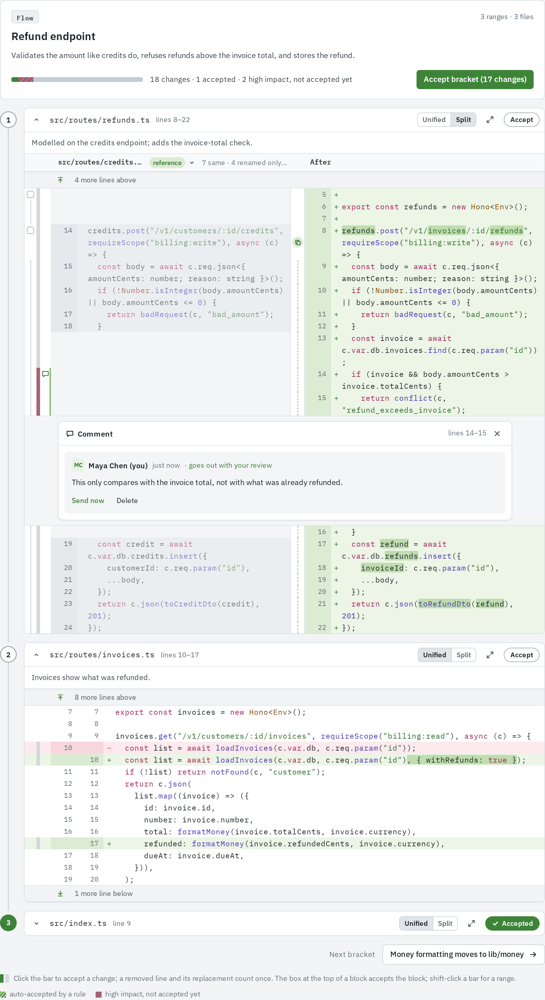
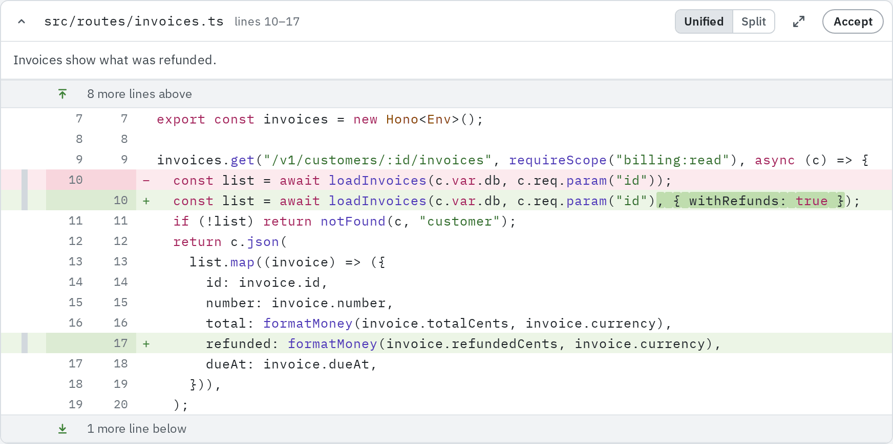
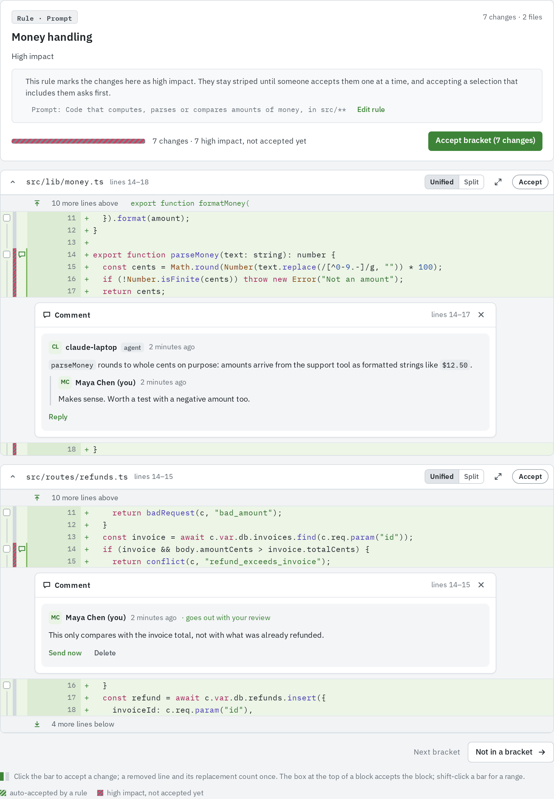
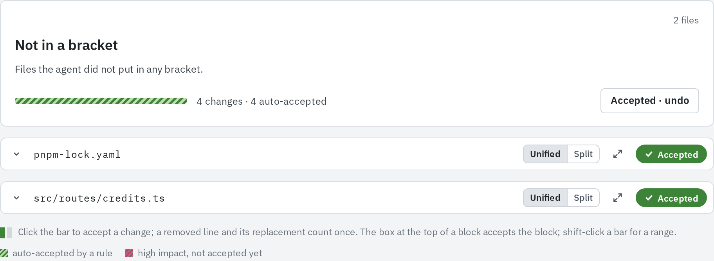

A bracket is a set of related line ranges, possibly across many files, with a title, a kind
and a description of what the lines do and why. The **Brackets** tab is where you review a pull
request by what it does rather than by file.

## Where brackets come from

- **The agent or the server** makes them. After an agent opens a pull request, it splits the
  change into brackets and sends them; when the server processes pull requests, the server's
  model does it instead. See
  [Pull request processing](/agent-workflows/pull-request-processing/).
- **Every revision** is bracketed again. Until its brackets arrive, the pull request shows as
  processing and the **Brackets** tab shows progress with **Review by file meanwhile**.
- **Every matched rule** adds a bracket of its own, listed under **Matched rules**. See
  [Rule brackets](#rule-brackets).
- **Files no bracket touches** are listed last, as **Not in a bracket** ("Files the agent did
  not put in any bracket.").

A line can sit in several brackets. Accepting it in one accepts it everywhere.

## Bracket kinds

Every bracket the agent or the server makes has one of these kinds, shown in small capitals
over its title:

| Kind        | What it holds                                                                                             |
| ----------- | --------------------------------------------------------------------------------------------------------- |
| `flow`      | One behaviour traced through every file it touches, in the order the code runs. Ranges are numbered steps |
| `schema`    | Database, API or contract changes, with the code that depends on them                                     |
| `refactor`  | A mechanical change that does not change behaviour                                                        |
| `rename`    | A rename carried through the code                                                                         |
| `move`      | Code moved from elsewhere; its ranges compare with where they came from                                   |
| `copy`      | Code copied from or modelled on existing code; its ranges compare with that reference                     |
| `generated` | Generated files; their diffs stay hidden until you click **Load diff**                                    |
| `config`    | Configuration                                                                                             |
| `tests`     | Tests                                                                                                     |
| `docs`      | Documentation                                                                                             |
| `other`     | Anything nothing above fits                                                                               |

The agent is asked to put risky lines (security, data loss, migrations, money, concurrency) in a
small bracket of their own and say why, and to order brackets with the core change first,
mechanical and generated ones last. How a move or a copy is shown is in
[Chunk context](/code-review/chunk-context/).

## The Brackets tab

On the left, the list of brackets. Each entry shows its kind, how much of it is left for you
("3 left", "accepted" or "auto-accepted"), its title, a progress bar, and its size ("4 ranges ·
3 files"). Click one to open it.

On the right, the open bracket:

- **A summary**: the kind, the title, the description, a progress bar with a line such as "7
  changes · 2 accepted", and **Accept bracket (N changes)**.
- **A card per range**, in the bracket's order. Its header holds a collapse chevron, the file
  path, the lines ("lines 21–29"), "moved from …" for moved code, **Compare with reference**
  when the range names one, the **Unified**/**Split** switch, **Open the whole file**, and the
  range's **Accept** pill. The agent's note on the range, if any, sits under the header.
- **Next bracket** at the bottom, with the next title.

The open bracket is in the URL (`…/brackets?bracket=<id>`).

## Reading a bracket

1. Read the title and description. They say what the lines do and why; check the code against
   them.
2. Read each range card in order. Ranges show only their lines with a few lines around them;
   open more from the stripes above and below, or click **Open the whole file** to see the
   whole file's diff over the page (**Open in Files** continues in the **Files** tab).
3. Accept a range with its pill when you are satisfied, or change by change with the bars. An
   accepted range collapses; a range stays open until you accept it.
4. Comment, flag or ask on lines that need it. See
   [Lines and chunks](/code-review/lines-and-chunks/#commenting-on-a-line-range).
5. Go on with **Next bracket**.

## Accepting a whole bracket

**Accept bracket (N changes)** accepts every change in the bracket's ranges that you have not
accepted yet; N is how many that is. Once all are accepted the button reads
**Accepted · undo**, which takes them all back. A change belongs to a range when its line is
inside it.

When the bracket holds high-impact changes as well as regular ones, accepting it asks first;
see [Accepting changes](/code-review/accepting-changes/#high-impact-changes).

## Auto-accepted lines in brackets

The agent is told every rule of the repository and asked to keep lines an auto-accept rule
covers out of its brackets, unless a bracket cannot be understood without them, such as the
import a new function needs. When such lines do sit in a range, they fold into a row such as
"2 auto-accepted lines by Import lines", and they already count as accepted. They show
unfolded only in the auto-accept rule's own bracket.

## Rule brackets

Each rule that matched something in the revision has a bracket under **Matched rules**, titled
with the rule's name. Its kind reads "Rule · Pattern" or "Rule · Prompt", and in the list "Rule
· Auto-accept", "Rule · High impact", "Rule · Review" or "Rule · Workflow". Its ranges are the
lines the rule matched.

The summary says what the rule does to these changes and what it matches, such as "File names:
pnpm-lock.yaml". A repository admin also gets **Edit rule**. For a rule that requires review,
the list reads "waiting on" and the reviewers' names until one of them has accepted every matched change, then
"reviewed by" and the name.

A rule bracket shows what the rule did, including how the agent judged a prompt rule. Levels and rules are explained in [Confidence levels](/code-review/confidence-levels/).

