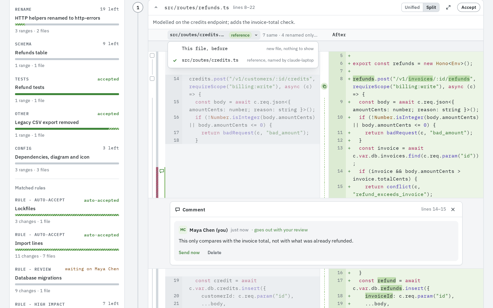
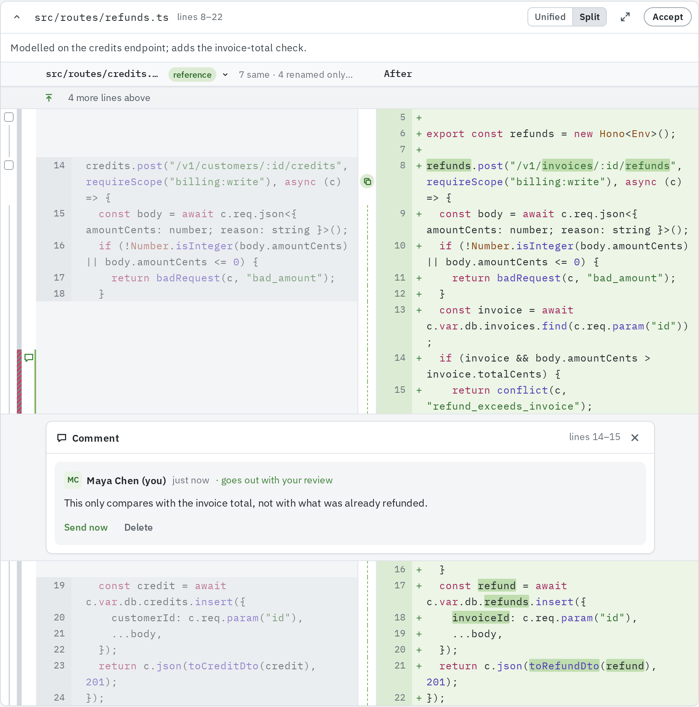
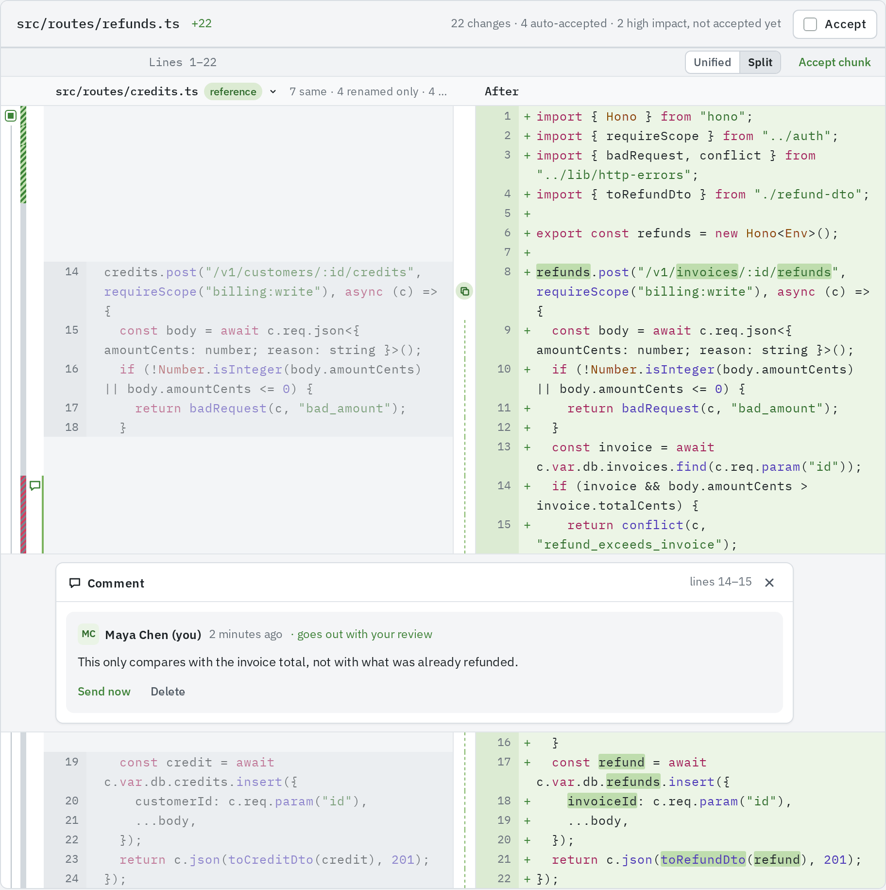
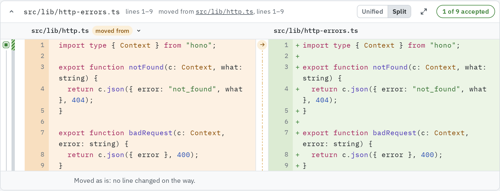
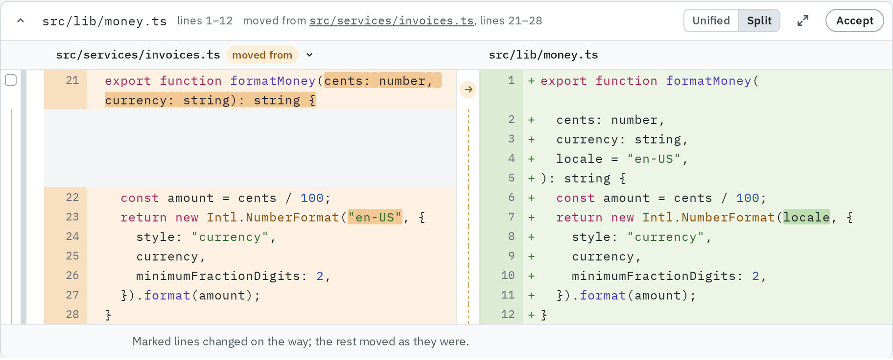

A range can say where its code came from: a reference implementation it was copied from or
modelled on, or the old lines it was moved from. The review shows that code beside the range
and marks only what differs.

The agent names both when it splits the change into brackets; the server's model does the same when the
server processes pull requests, reading the repository to find references.

## The left side of a split diff

In **Split** layout, the left side's name is a menu (**Left side: …**). It offers:

- **This file, before**: the usual diff ("new file, nothing to show" for an added file).
- For moved code, the path it came from, tagged **moved from**.
- For copied code, the reference's path, tagged **reference**, with "reference, named by
  claude-laptop" (the agent's name). A range with no reference shows **Reference implementation** greyed out, "none
  named for these lines".

A range with a reference or an origin opens in **Split** already compared with it. Switch to
**Unified**, or pick **This file, before**, to see the plain diff.

## Reference implementations

A reference is existing code on the target branch, as it was at the pull request's base, that
the range was copied from or built on: a new route modelled on an existing route, a test
copied from its neighbour. It can be in any file, not only one the change touches.

**How it looks**

- The reference is on the left, greyed, with its own line numbers. The new lines are on the
  right in green, and only the characters that differ from the reference line beside them are
  marked.
- A copy icon in the middle column marks where a run of referenced lines starts, and a dashed
  line runs down the rest of it.
- Reference lines the copy left out appear on the left with a **left out** tag and nothing on
  the right.
- Lines new in the copy appear on the right with nothing on the left.
- Point at a row to see how it compares, such as "Reference line 12: differs from the
  reference only by name" or "Reference line 12, left out of the copy".
- The left side's header sums it up: "15 same · 3 renamed only · 9 changed · 2 new · 1 left
  out".

Only lines the change adds outright are compared with the reference. A line that replaces an
old line is still shown against the line it replaces.

**Where it shows**

- In **Brackets**, the range card opens compared with its reference. **Compare with reference**
  in the card header brings the comparison back after you switched away.
- In **Files**, the chunk that overlaps a range with a reference opens compared with it; other
  chunks open as usual. The chunk header carries **Compare with reference**.

A script can read a reference the same way; see
[Pull requests](/api/user/pull-requests/#get-apirepositoriesnamepull-requestsnumberreference).

## Moved code

Moved code names the lines it came from in the old version of a file the change took them out
of. Cut-and-paste refactors, functions moved between files and renamed files read as moves.

**How it looks**

- The range card header says where from, such as "moved from src/lib/http.ts, lines 1–9"; the path
  opens that file in **Files**.
- The card opens in **Split** with **Left side: src/lib/http.ts**, tagged **moved from**. The origin
  is on the left in light orange with its old line numbers, the moved lines on the right in
  green.
- An arrow in the middle column marks the first row, and a dashed line runs down the rest.
- Lines that changed on the way are marked. An origin line that did not make it shows on the
  left only; a line new here shows on the right only.
- A line under the lines says which case it is: "Moved as is: no line changed on the way." or
  "Marked lines changed on the way; the rest moved as they were."

Moved code is compared only in **Brackets**. In **Files**, the moved lines are ordinary added
lines in their new file, and the origin's lines are removed lines in theirs.

**Accepting a move**

The bars and the range pill accept the moved lines as changes of their new file. The lines
removed from the origin are changes of the origin file; accept them where they show, usually
as another range of the same bracket.

