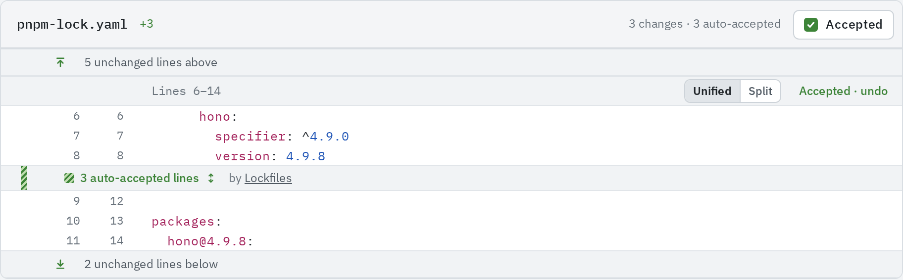
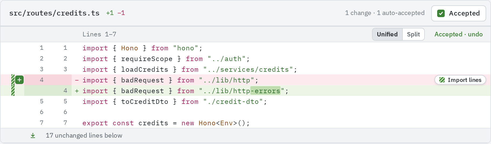
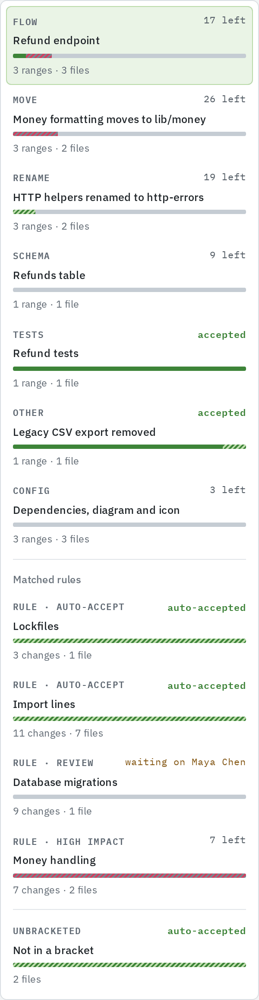
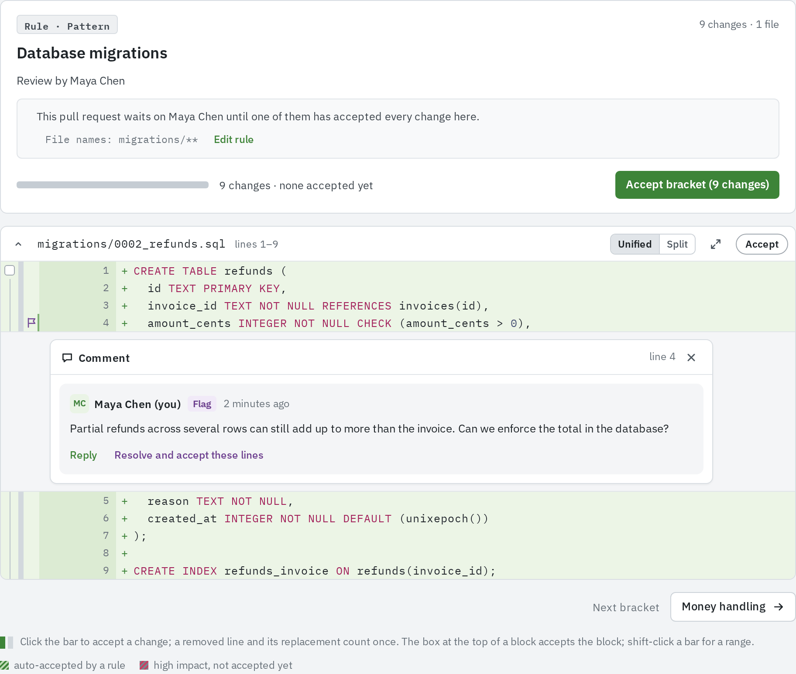
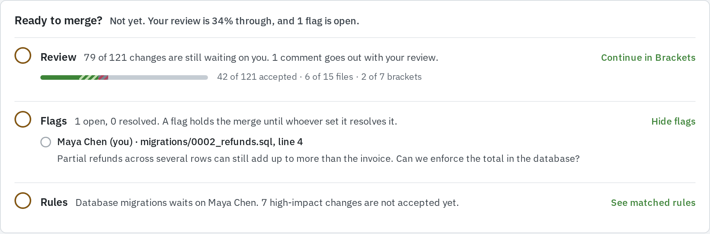

Rules set a level on the changes they match. An auto-accept rule accepts them for everyone, a
high-impact rule marks them until each is accepted, and a require-review rule waits on named
people. Rules are created per
repository under **Settings › Rules**; see [Rules](/administration/rules/).

## The levels

| Action (as the rule form names it) | What it does to the review                                                                                       | How it looks                                                                         |
| ---------------------------------- | ---------------------------------------------------------------------------------------------------------------- | ------------------------------------------------------------------------------------ |
| **Auto-accept**                    | Matched changes count as accepted for everyone. Anyone can undo one for themselves and review it                 | Green-striped bars; runs fold into "N auto-accepted lines by" the rule's name        |
| **Mark as high impact**            | Matched changes wait until you accept them, and accepting a selection that sweeps them up with others asks first | Grey-and-red striped bars that never fold; a grey-and-red part in every progress bar |
| **Require review by**              | The pull request waits on the named people until one of them has accepted every matched change themselves        | No mark in the code; the rule's bracket reads "waiting on …", then "reviewed by …"   |
| **Run a workflow**                 | Starts a GitHub Actions workflow on the branch for each revision that matches. Reviewers still read the changes  | A rule bracket listing the matched lines                                             |
| **Mark exclusive**                 | Does not change the review: it tells an agent session that takes a file another session holds                    | Nothing in the review                                                                |

A change several rules match keeps every action: it can be auto-accepted by one rule and still
wait on a named reviewer from another.

:::caution
"Waits on" is what **Ready to merge?** shows, not a lock. The merge button does not check open
high-impact changes or require-review rules. Read **Ready to merge?** before merging.
:::

High-impact progress is per person, like the rest of your review: a high-impact change stays
striped for you until you accept it, whatever other reviewers did.

## How rules match

There are two kinds of rule.

**Pattern match** rules are deterministic and run when the review first counts a revision's
changes:

- **File names** match every change in a file whose path matches a glob or a regular
  expression, such as `pnpm-lock.yaml` or `**/*.gen.ts`.
- **Code structure** matches changes whose lines all sit inside import statements (`import`,
  `export … from`, `require()`) or comments, JSDoc included, in JavaScript and TypeScript
  files. A change that also touches code does not match.

**Prompt** rules describe in words what to look for, such as "Any change to how totals are
computed". The agent that processes the pull request, or the server's model, judges each change
against them and sends the lines it matched with its brackets. The rule's bracket lists those
lines. Both kinds can be kept to part of the repository
with **Only in files matching**.

## Rules are fixed per revision

The repository's rules that are on are copied onto a pull request each time a revision is
stored. Editing a rule, turning it off or deleting it never changes a review already open; it
applies from the pull request's next revision. Prompt rules are judged again for each revision.

## How each level appears in the review

- **In the code**, the bar beside each change shows its level (see
  [Accepting changes](/code-review/accepting-changes/#what-the-bar-beside-a-line-shows)).
  Pointing at an auto-accepted or high-impact line shows a chip with the rule's name that
  links to its bracket.
- **In Brackets**, every rule that matched has its own bracket under **Matched rules**. See
  [Rule brackets](/code-review/brackets/#rule-brackets).
- **On the Overview tab**, **Ready to merge?** has a **Rules** line: who each require-review rule
  still waits on ("Database migrations waits on Maya Chen."), how many high-impact changes are not
  accepted yet, or how many rules matched and how many changes were auto-accepted. **See matched
  rules** opens their brackets, starting with a rule still waiting.

