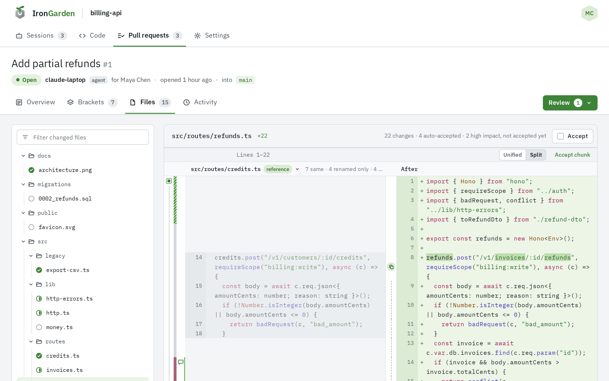
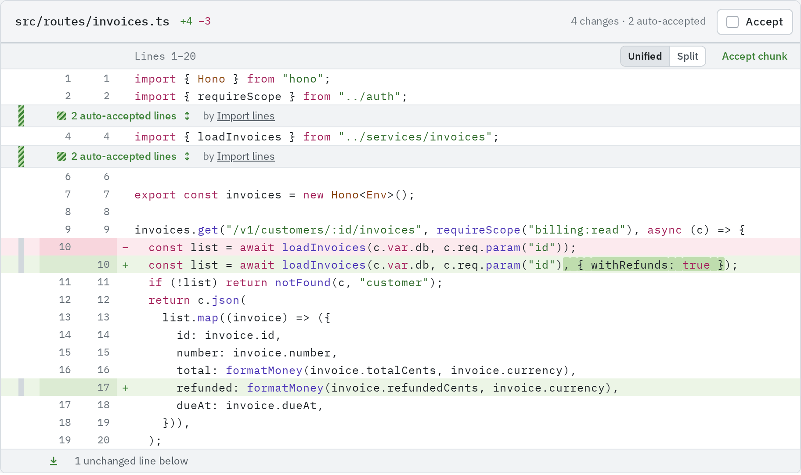
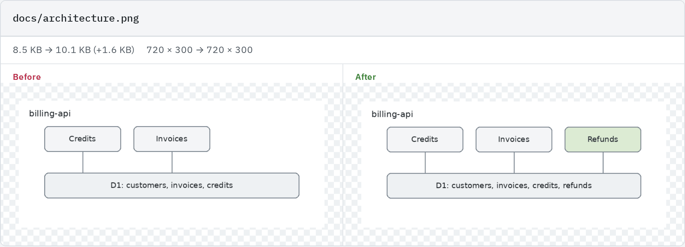
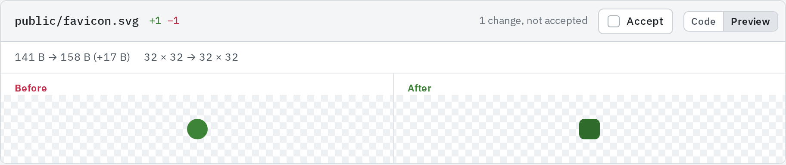
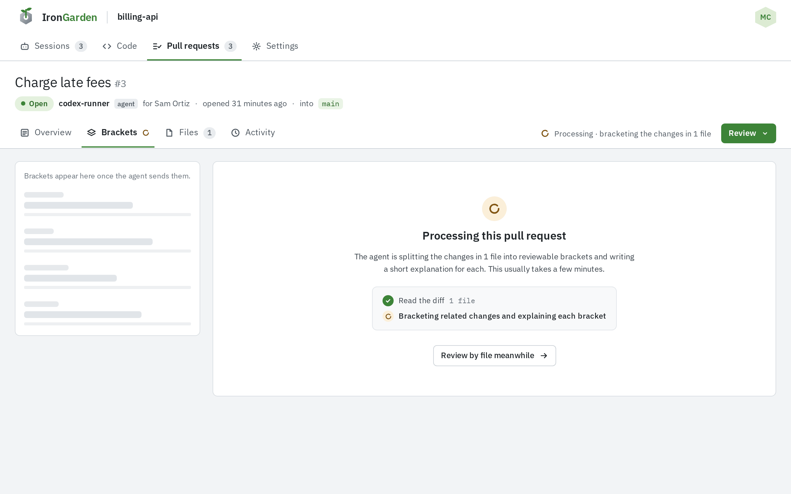

The **Files** tab reviews a pull request file by file, the way most review tools do, with the
same changes, comments and accept controls as [Brackets](/code-review/brackets/). What you
accept in one tab is accepted in the other.

## Layout

- On the left, the **Changed files** panel: a **Filter changed files** box and a tree of the
  files the pull request changes. Each file has a state icon: a filled tick when you accepted
  all of it, a half-filled circle when partly, an empty circle when not at all.
- On the right, one file at a time. Its heading shows the path, how many lines it adds and
  removes (such as "+12 −3"), how far you are through it ("1 of 3 changes accepted"), and the
  file's **Accept** checkbox.
- Below the file, **Next file** opens the next one in the tree, and a legend explains the bars.

The selected file is in the URL (`…/pulls/<number>/files?file=<path>`).

## Reading a file

The file shows as chunks: its changes with three unchanged lines on each side, and the
unchanged lines between them folded. Each chunk has a header with its lines ("Lines 14–21",
or "Removed lines 3–5" for a chunk that only removes), its own **Unified**/**Split** switch,
and **Accept chunk**.

- Open a fold with its arrow buttons, 20 lines at a time, or with the declaration button that
  opens it up to the function or type the next chunk sits in.
- Changes an auto-accept rule matched fold into a row such as "4 auto-accepted lines"; click
  to unfold them.
- A chunk whose lines name a reference implementation opens in **Split** beside it, with
  **Compare with reference** in its header to bring that back. See
  [Chunk context](/code-review/chunk-context/#reference-implementations).
- Comment on lines with the **+** in the note column; see
  [Lines and chunks](/code-review/lines-and-chunks/#commenting-on-a-line-range).

A file with no changed lines reads "No line changed."; an empty file reads "Empty file.".

## Images and other binary files

A changed raster image (PNG, JPEG, GIF, WebP, AVIF, BMP or ICO) shows its two versions side by
side, labelled **Before** and **After**, above a line with how its size and dimensions changed,
such as "235 B → 389 B (+154 B)" and "96 × 48 → 160 × 80". An added or deleted image shows one
side.

An SVG is text, so it shows as a diff. The **Show the change as** switch in its heading flips
between **Code** and **Preview**, which draws the two versions as pictures.

Any other binary file reads "Binary file. Its diff is not shown.", and a file too large to show
reads "Too large to show (…)". An image, a binary file or a file too large to show is one
change: accept it with the file's **Accept**.

## Generated files

A file the agent put in a bracket of kind _generated_ opens as "Generated file. Its diff is
hidden." with **Load diff**. Click **Load diff** to read it.

## Files and the code browser

The **Files** tab lists only the files the pull request changes, as its latest revision has
them. To read a file the change does not touch, or a branch as it is, use the repository's
**Code** tab, which browses any branch or commit. Commit links on the pull request's
**Activity** tab open the code browser at that commit.

From a range card in **Brackets**, **Open the whole file** shows that file's whole diff over the
page, with **Open in Files** to continue here.

## Files and Brackets

- **While the pull request is processing**, the **Brackets** tab offers **Review by file
  meanwhile** and the Overview tab **Start in Files**.
- **When processing failed**, a notice reads "The server could not bracket this pull request",
  and every change is under **Files**.
- **Not in a bracket** lists only files that no bracket touches. A changed line outside every
  range, in a file some bracket does touch, shows only in **Files**.

