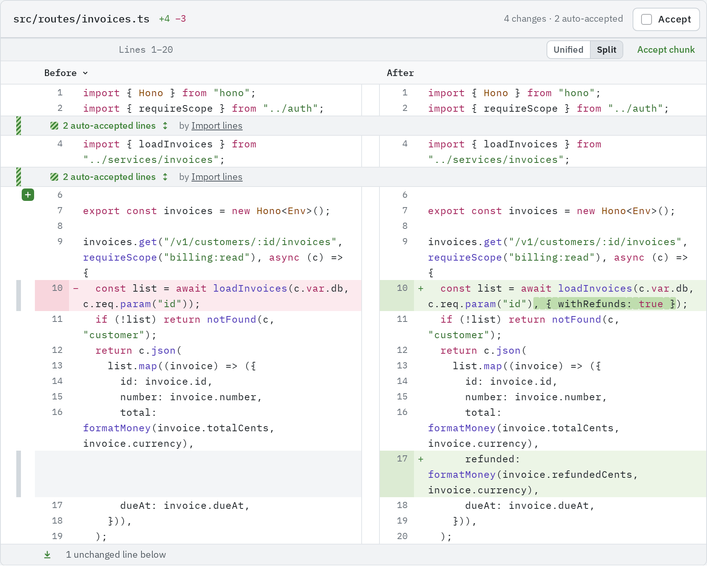
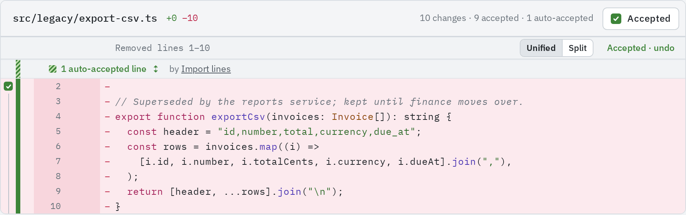
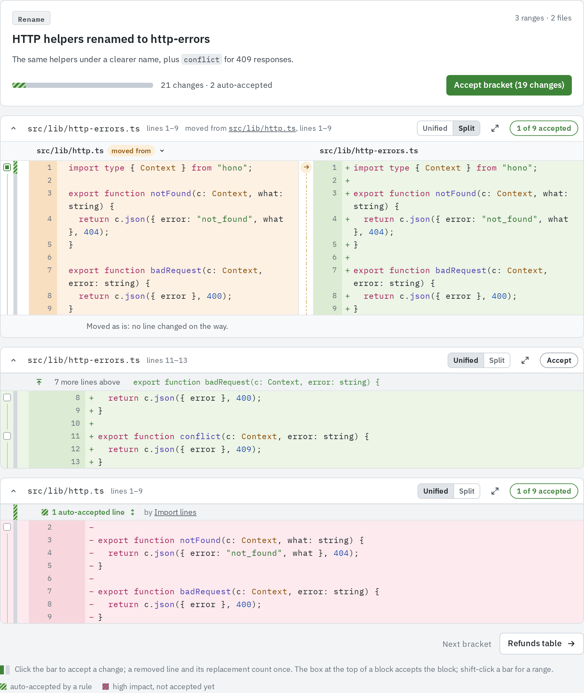
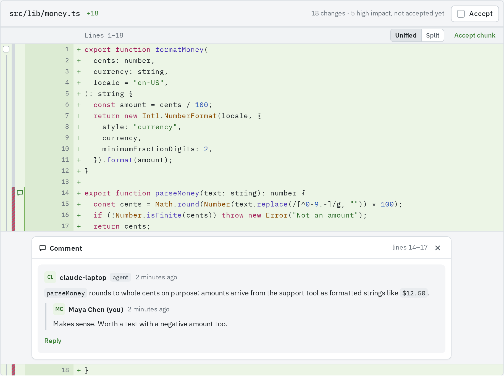
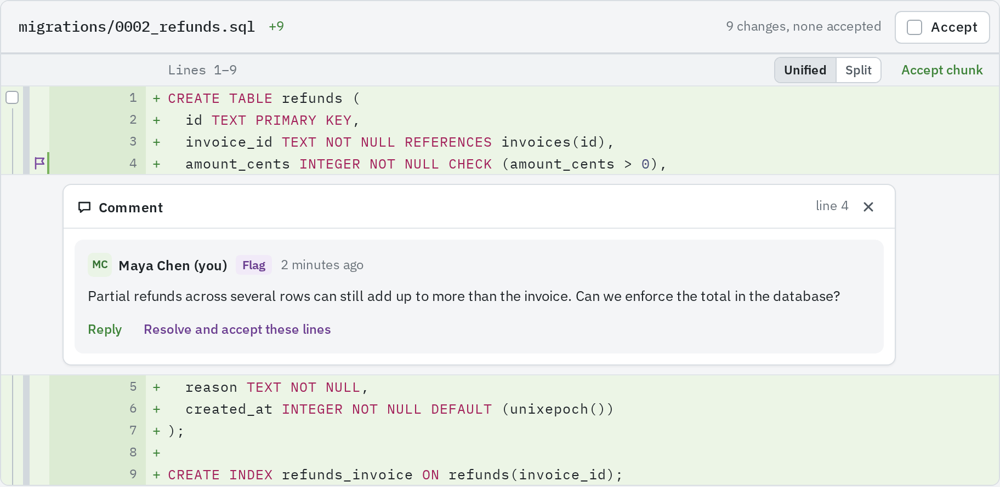

In %PRODUCT_NAME% you review a pull request change by change, not file by file. Every changed
line is either accepted by you, accepted by a rule, or still waiting.

## Changes and chunks

A **change** is one added or removed line, or a removed line and the added line that replaced
it, which count as one. A **chunk** is a range of adjacent lines in a file.

Every count in the review counts changes, not lines: "3 changes, none accepted", "1 of 3
changes accepted". A change is the smallest thing you can accept. How to accept them is in
[Accepting changes](/code-review/accepting-changes/).

## How a diff is shown

- **Unified** is the default. Each row has two line-number columns, the old file's then the
  new file's, a `+` or `−`, then the code in syntax colours. Removed lines are red and added
  lines green.
- When an added line replaces a removed one, the characters that differ between the two are
  marked.
- **Split** shows **Before** on the left and **After** on the right. Each chunk (in **Files**)
  and each range card (in **Brackets**) has its own **Unified**/**Split** switch.
- Unchanged lines between chunks fold into a stripe such as "42 unchanged lines". Its arrow
  buttons show 20 more lines from the top or the bottom. When the fold hides the start of the
  function or type the next chunk sits in, that declaration's first line appears on the
  stripe as a button that opens the fold up to it.
- Left of the line numbers sit three narrow columns: the box that accepts a run of changed
  lines, each change's bar, and the note column for comments.

## Added, deleted and renamed files

- **Added file**: every line is added, numbered on the new side only.
- **Deleted file**: every line is removed. Ranges and comments on it count the old file's
  lines.
- **Renamed file**: %PRODUCT_NAME% does not detect renames. A renamed file shows as its old path
  deleted and its new path added. When the agent marks the new lines as moved from the old
  path, the move's bracket compares them with the original, and an unchanged rename reads as
  "Moved as is". See [Chunk context](/code-review/chunk-context/#moved-code).
- **Binary or too large**: no lines are shown ("Binary file. Its diff is not shown." or "Too
  large to show (…)"). The whole file counts as one change, accepted with the file's
  **Accept**. Changed images show their two versions; see
  [Files view](/code-review/files-view/#images-and-other-binary-files).
- **Generated files**: a file the agent put in a bracket of kind _generated_ waits behind
  "Generated file. Its diff is hidden." until you click **Load diff**.

## How lines are numbered

Brackets, comments and the chat all name lines the same way: by their number in the new
version of the file. A removed line belongs to the new line that follows it, or to the last
line when it ends the file. In a deleted file, numbers count the old version.

## Commenting on a line range

1. Point at a line in **Files** or **Brackets**. A **+** button appears in the note column,
   labelled "Comment on line N".
2. Click it for that line alone. To take in more lines, drag down from it, or shift-click the
   **+** of another line. A **New comment** card opens under the last line, showing the range,
   such as "lines 17–18".
3. Write the comment. Markdown works.
4. Pick what it is with the arrow beside the submit button (**Kind of comment**): **Accept**,
   **Flag**, **Comment** or **Ask**. The button takes that name.
5. Click it.

A range with comments shows a mark in the note column on its first line: a speech bubble, or a
flag while a flag on it is open, with a count when several threads share the lines. Threads
whose lines overlap share one card under their last line. Close a card with its **×**; click
the mark to open it again.

Replies are one level deep: **Reply** answers the comment that starts the thread, never a
reply. A reply goes out at once, and only to a comment that has already gone out.

Agents comment too, marked with an _agent_ tag, on an unorthodox decision or hard code, and
they answer your comments. Agents cannot flag, accept or ask.

## Comment, flag, accept or ask

| Kind        | What it does                                                             | When it goes out                                    |
| ----------- | ------------------------------------------------------------------------ | --------------------------------------------------- |
| **Comment** | A note on the lines                                                      | With your review                                    |
| **Flag**    | Asks for a change. It stays open until the person who set it resolves it | With your review                                    |
| **Accept**  | Accepts the lines and leaves a note on them                              | The accept at once; the note with your review       |
| **Ask**     | A question to the agent                                                  | At once; into the chat whenever the chat is offered |

- A flag shows a **Flag** badge, is listed under **Flags** in the Overview tab's
  **Ready to merge?**, and marks its lines with a flag icon. Once it has gone out, its author
  resolves it with **Resolve and accept these lines** (or **Resolve** where its lines are not
  on screen), or reopens it with **Reopen**.
- An accept shows an **Accepted** badge, an ask a **Question** badge.
- Whenever the pull request offers the chat, **Ask** sends the question there,
  with the lines as context, and leaves no comment on the lines. See
  [Agent chat](/code-review/agent-chat/#asking-about-lines).

## Drafts and your review

Your comments, flags and accepts are drafts: only you see them, and each reads "goes out with
your review". A draft has **Send now**, to send it alone, and **Delete**. The **Review** button
at the top right of every tab counts your pending drafts, and sending your review sends them
all at once with a verdict and a note. The steps are in
[Accepting changes](/code-review/accepting-changes/#sending-your-review).

A script working as you can send a review with a personal API key; see
[Reviews](/api/user/reviews/#post-apirepositoriesnamepull-requestsnumberreviews).
