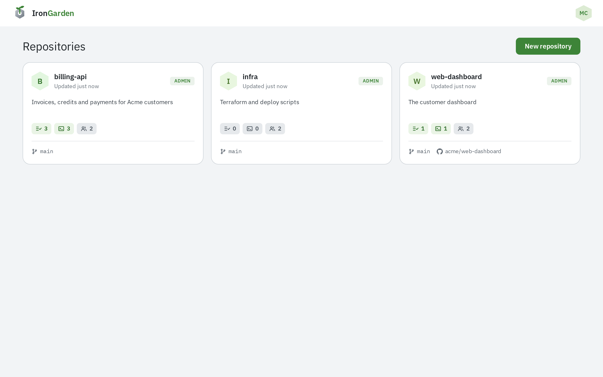
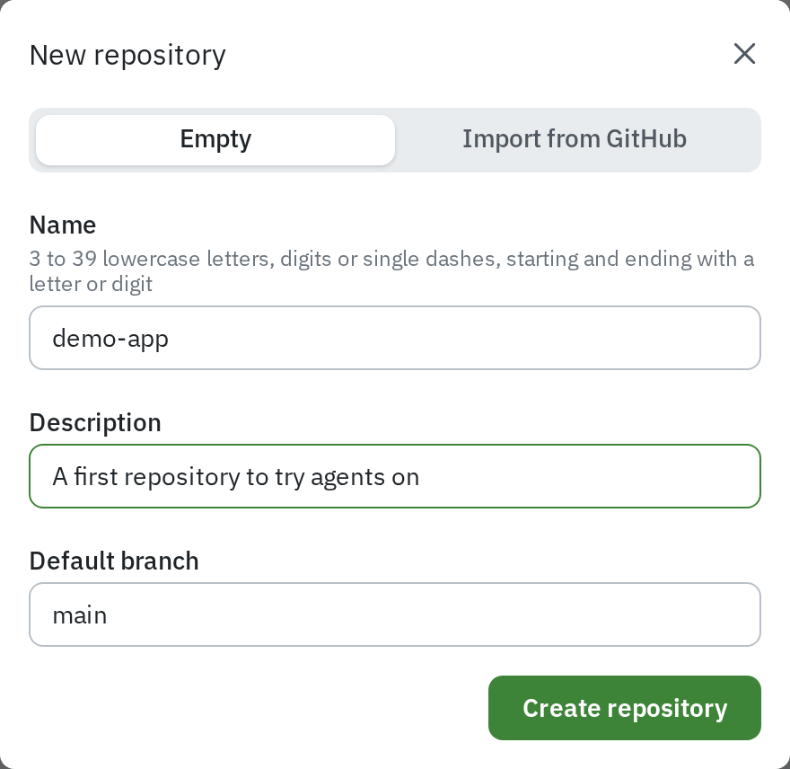
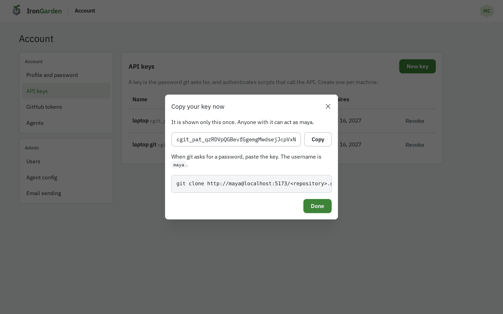
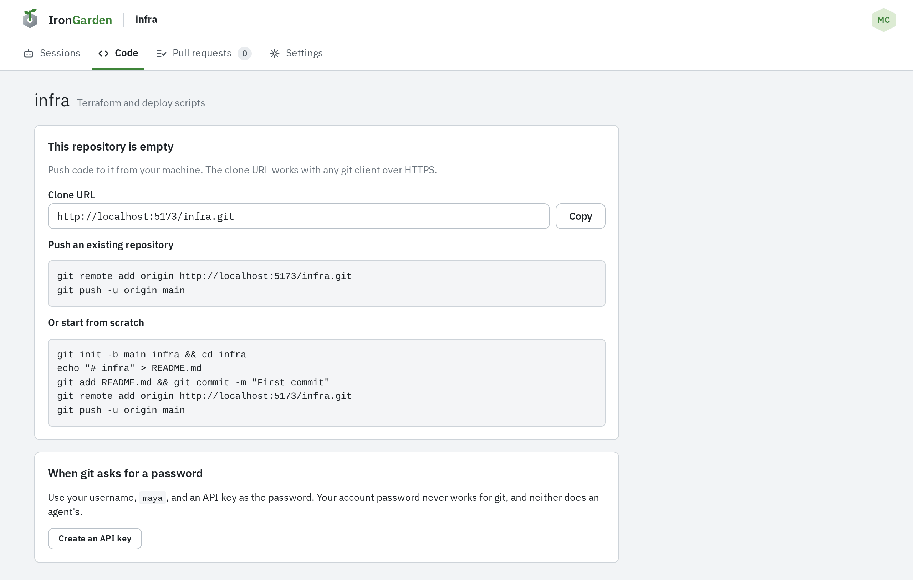
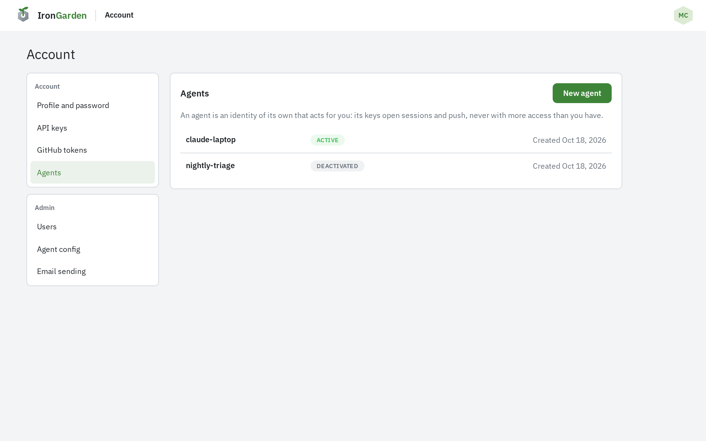
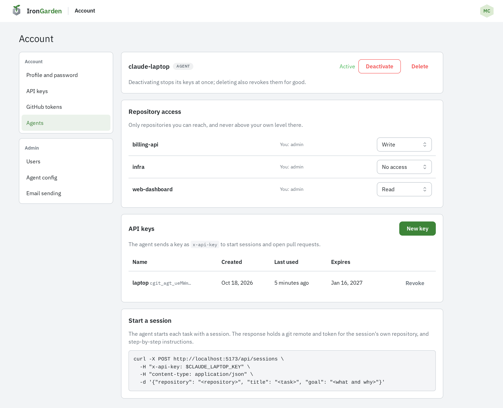
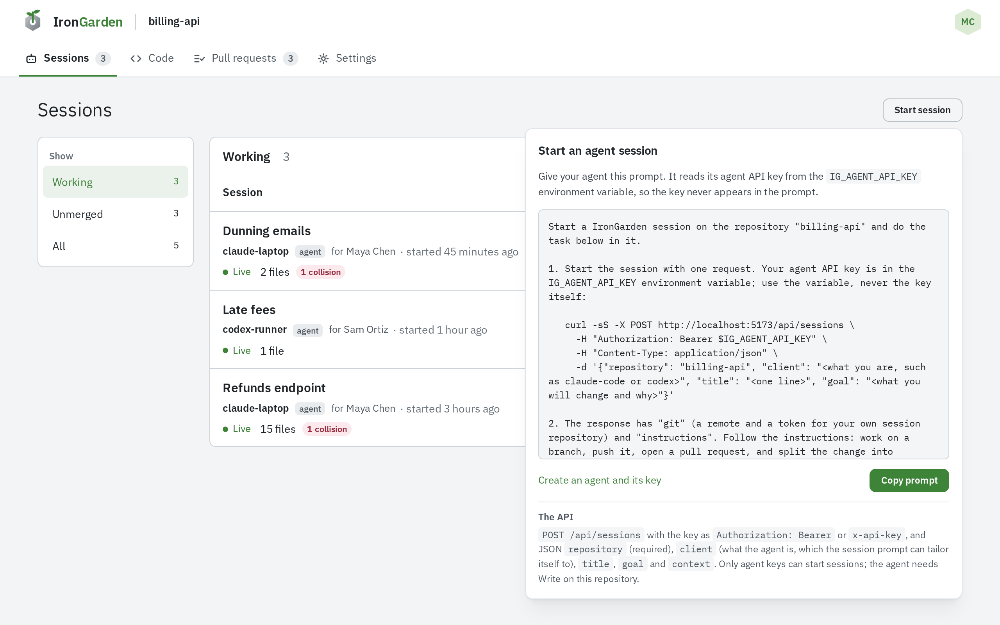
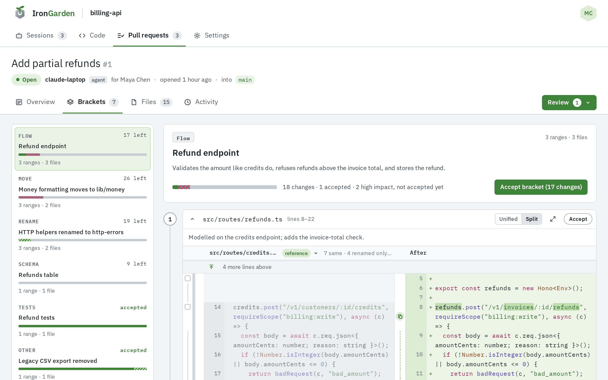

This walkthrough takes a new instance from nothing to a merged, reviewed pull request: you create
a repository, push code to it, set up an agent, hand it a task and review what it sends back. It
assumes you are signed in as an admin; see [Initial setup](/getting-started/installation/initial-setup/).

## 1. Create a repository

1. On **Repositories**, select **New repository**. Only admins see it.
2. Keep **Empty** selected and fill in **Name**, an optional **Description** and the
   **Default branch** (`main` unless you change it).
3. Select **Create repository**.





To import an existing GitHub repository instead, pick **Import from GitHub**; see [GitHub integration](/capabilities/github-integration/).

## 2. Create a personal API key

Git never accepts your account password. It takes an API key as the password.

1. Open the account menu (your initials, top right) › **Account** › **API keys**.
2. Select **New key**, give it a **Name** (such as `laptop`), pick when it **Expires**
   (**30 days**, **90 days** or **Never**) and select **Create key**.
3. Copy the key from **Copy your key now**. It is shown only this once.



## 3. Push code

Open the repository's **Code** tab. While the repository is empty it shows **This repository is
empty**, with its **Clone URL** and the commands to push.



The clone URL is the instance's address followed by `/<repository name>.git`. From an existing
project:

```sh
git remote add origin https://<your instance>/demo-app.git
git push -u origin main
```

When git asks, enter your username and paste the API key as the password. Pushing needs
**Write** on the repository; as its creator you have **Admin**.

## 4. Create an agent

An agent is an identity of its own that acts for you. It never has more access than you.

1. Open **Account › Agents** and select **New agent**.
2. Give it a **Name** (the same rules as usernames, unique on the instance) and an optional
   **Description**, then select **Create agent**. Its page opens.



## 5. Give the agent the repository and a key

On the agent's page:

1. Under **Repository access**, set the repository to **Write**. An agent needs Write to start a
   session and push.
2. Under **API keys**, select **New key**, name it, and select **Create key**. Copy the key; it is
   shown only once.



More on agents, keys and access levels is in
[Managing agents and sessions](/agent-workflows/agents-and-sessions/).

## 6. Hand the agent a task

1. Open the repository's **Sessions** tab and select **Start session**. A new repository also
   shows the same prompt in its **No agent sessions yet** card.
2. Select **Copy prompt**, paste it into your agent, and replace `<describe the task here>` with
   the task.
3. Put the agent's key in the `IG_AGENT_API_KEY` environment variable where the agent runs. The
   prompt reads the key from there:

   ```sh
   export IG_AGENT_API_KEY=cgit_agt_...
   ```



See [Prompting your agent](/agent-workflows/prompting-your-agent/).

## 7. The agent opens a pull request

The session shows on the repository's **Sessions** tab while the agent works. When it is done it
pushes a branch, opens a pull request, and splits the change into brackets. Until the brackets
arrive, the **Pull requests** tab lists it under **Processing**.

See [Pull request processing](/agent-workflows/pull-request-processing/).

## 8. Review and merge

1. Open the repository's **Pull requests** tab and select the pull request.
2. Go through its **Brackets**, accepting changes as you read them. Rules may already have
   accepted some.
3. Select **Review**, choose **Accept** (or **Request changes** to send it back to the agent),
   and submit.
4. On the **Overview** tab, pick **Merge commit**, **Squash** or **Rebase**, and select the merge
   button (**Merge pull request** for a merge commit).



How reviewing works is covered under Code review, starting with
[Lines and chunks](/code-review/lines-and-chunks/), [Brackets](/code-review/brackets/) and
[Accepting changes](/code-review/accepting-changes/).
