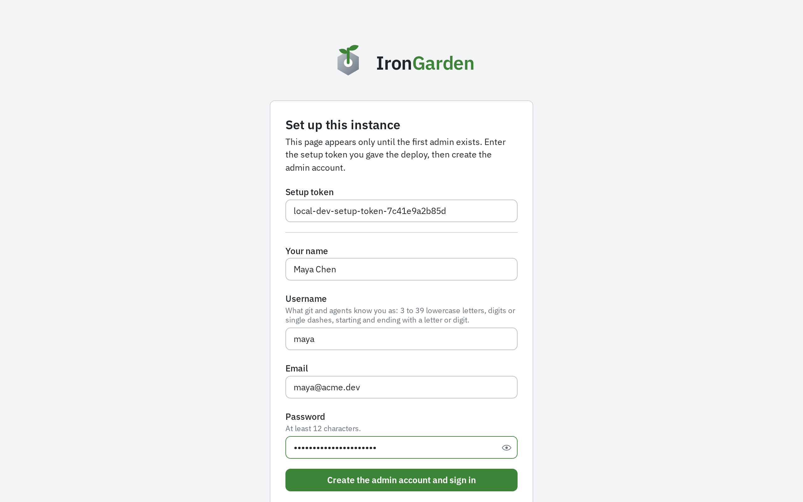

A new instance has no users. Its first visit shows a setup form that creates the first admin
with the `SETUP_TOKEN` you chose when you deployed. The form switches itself off for good once an
admin exists.

## Create the first admin

1. Open the instance's URL. Instead of the sign-in page, it shows **Set up this instance**.
2. Fill in the form:

   | Field           | What to enter                                                                                                                    |
   | --------------- | -------------------------------------------------------------------------------------------------------------------------------- |
   | **Setup token** | The `SETUP_TOKEN` secret you set when you deployed.                                                                              |
   | **Your name**   | Your display name.                                                                                                               |
   | **Username**    | What git and agents know you as: 3 to 39 lowercase letters, digits or single dashes, starting and ending with a letter or digit. |
   | **Email**       | Your email address. You can sign in with it or with your username.                                                               |
   | **Password**    | At least 12 characters.                                                                                                          |

3. Select **Create the admin account and sign in**.

The app signs you in as the instance's first admin.

Next, walk through your first repository and pull request in
[First run](/getting-started/first-run/).
