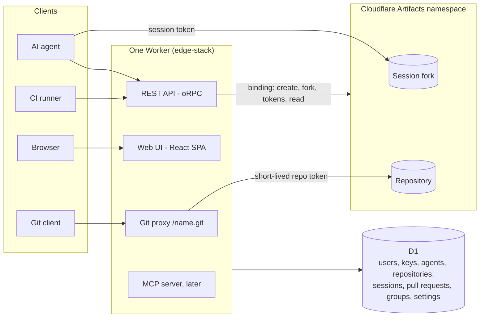

# Architecture

Everything runs in one Worker (the edge-stack backend). Git data lives in
[Cloudflare Artifacts](https://developers.cloudflare.com/artifacts/): every repository is an
Artifacts repo, and every agent session works in its own Artifacts fork of it. The Worker owns
identity, access and review; Artifacts owns git storage and the git protocol. The TypeScript
git engine in [git-engine.md](./git-engine.md) is no longer on the critical path: it stays the
fallback if Artifacts cannot serve a need (see _Pluggable storage_).

## Request routing

| Path                                                                                   | Handler                                                                                                                                                                                                                                                                  |
| -------------------------------------------------------------------------------------- | ------------------------------------------------------------------------------------------------------------------------------------------------------------------------------------------------------------------------------------------------------------------------ |
| `/<name>.git/info/refs`, `/<name>.git/git-upload-pack`, `/<name>.git/git-receive-pack` | Git proxy. HTTP Basic auth: username is ignored, the password is an API key. The Worker checks Read (fetch) or Write (push) through `libs/forge`, mints a short-lived Artifacts token of the matching scope and streams the request to the repository's Artifacts remote |
| `/api/auth/*`                                                                          | better-auth: sign-in, sessions, the admin plugin and the API key plugin                                                                                                                                                                                                  |
| `/api/*`                                                                               | oRPC API served as REST (edge-stack contract pattern), used by the web UI, agents and CI. Accepts a browser session or an API key                                                                                                                                        |
| `/mcp`                                                                                 | Remote MCP server for agents (later)                                                                                                                                                                                                                                     |
| everything else                                                                        | The React SPA, admin pages included                                                                                                                                                                                                                                      |

## Identity and keys

better-auth is the only identity system:

- **Users** sign in with username or email and a password (email + password and username
  plugins). The **admin plugin** gives users a `role` (`user` or `admin`) and a ban flag that
  deactivates them; admins manage users through its endpoints.
- **API keys** come from the API key plugin. A key belongs to a user; `metadata.kind` is
  `user` for a personal key and `agent` (with `metadata.agentId`) for a key of one of the
  user's agents. Keys are prefixed `cgit_pat_` and `cgit_agt_`, stored hashed and shown once.
- **Principals.** Every request resolves to one principal before any domain call: a user
  (browser session or personal key) or an agent (agent key, acting for its owner). A banned
  owner disables their agents' keys too.

## Storage split

| Store                                               | Holds                                                                                                                                                                                        | Why there                                                                                                                                                                               |
| --------------------------------------------------- | -------------------------------------------------------------------------------------------------------------------------------------------------------------------------------------------- | --------------------------------------------------------------------------------------------------------------------------------------------------------------------------------------- |
| Cloudflare Artifacts (one namespace per deployment) | Git data of every repository and every session fork                                                                                                                                          | Git-native storage and git smart HTTP without our own engine; repo-scoped tokens let agents push to their session fork and nothing else                                                 |
| D1 (edge-stack DB)                                  | Users, keys, agents, repositories, access, sessions and context, pull requests, revisions, changed files, groups, instance settings; later review marks, rules, artifacts, checks, audit log | Relational queries across repos; already wired with Drizzle and migrations                                                                                                              |
| Coordination Durable Object (later)                 | Per repo: active working sets, exclusive-path holds, overlap state                                                                                                                           | Strongly consistent claims: two sessions racing for an exclusive path get one winner ([agent-collaboration.md](./agent-collaboration.md))                                               |
| Job runner Durable Object (later)                   | Background jobs from push, merge and change events (alarm-driven)                                                                                                                            | Diff analysis, rules, post-merge impact, webhooks run after the push returns; works in previews, where Queue consumers do not ([testing.md](./testing.md#background-jobs-and-previews)) |
| Workers AI (later)                                  | Default model for platform-side AI features                                                                                                                                                  | Works with zero keys on a fresh deploy. POC grouping runs in the agent, not here                                                                                                        |

Artifacts names are derived from ids, never from user-chosen names: a repository's Artifacts
repo is named after its id, so renaming a repository changes only its clone URL on the
instance. A session fork is named after the session id.

## Push and fetch

People push and fetch through the Worker's git proxy, so access is decided in one place and API
keys are the only git credential a person holds. Agents in a session talk to their session
fork directly, with the session token; the main repository's default branch only moves
through a merge on the platform.

## Pull requests and diffs

A pull request records the session fork, the branch, its head commit and the base commit
(the default branch at fork time). The Worker diffs the two trees through the Artifacts
binding (`readTree`, `readBlob`) to list changed files and check group ranges. Groups come
from the agent (see [agent-collaboration.md](./agent-collaboration.md)); the platform stores
and validates them but does not compute them in the POC.

## Merges (later)

Merging writes the pull request's commits into the main repository. Artifacts has no merge
call, so the Worker fetches from the fork and pushes to the main repository with a git client
that runs in Workers (isomorphic-git over the Artifacts remote). A conflict blocks the merge;
the agent rebases in its session and pushes again.

## Pluggable storage

Git operations the Worker needs sit behind one interface (`libs/git-host`: create, fork,
delete, tokens, resolve a ref, read trees and blobs, proxy the git protocol). Artifacts is its
only implementation. If a deployment cannot use Artifacts, the engine in
[git-engine.md](./git-engine.md) becomes a second implementation behind the same interface.

## Package layout (on top of edge-stack)

| Package                                            | New or existing | Role                                                                                                                                                                                                               |
| -------------------------------------------------- | --------------- | ------------------------------------------------------------------------------------------------------------------------------------------------------------------------------------------------------------------ |
| `libs/git-host`                                    | New             | The Artifacts binding behind a small interface: repos, forks, tokens, refs, tree diff, the git proxy                                                                                                               |
| `libs/forge`                                       | New             | Repositories, members, agent access, principals and `can()`; the one place authorization is decided                                                                                                                |
| `libs/collab`                                      | New             | Agent sessions and their forks; later working sets, the coordination Durable Object, overlap and exclusive paths, notifications, messaging, post-merge impact ([agent-collaboration.md](./agent-collaboration.md)) |
| `libs/review`                                      | New             | Pull requests, revisions, changed files, groups and the grouping prompt; later line ranges, review marks and carry-over, references, rules, merge ([code-review.md](./code-review.md))                             |
| `libs/evidence`                                    | Later           | Artifacts uploads, metric comparison, image-to-line links, competing change requests                                                                                                                               |
| `libs/ai`                                          | Later           | Provider abstraction (Workers AI, optional external key via AI Gateway) for platform-side AI                                                                                                                       |
| `libs/mcp`                                         | Later           | MCP tool definitions over `libs/review` and `libs/collab`                                                                                                                                                          |
| `libs/git-core`                                    | Fallback        | The TypeScript git engine, only if a storage backend other than Artifacts is needed                                                                                                                                |
| `libs/contract`, `libs/db-models`, `libs/identity` | Existing        | Extended with the new endpoints, tables, the admin and API key plugins, and principals                                                                                                                             |
| `apps/backend`                                     | Existing        | Mounts the git proxy and the API                                                                                                                                                                                   |
| `apps/frontend`                                    | Existing        | The whole UI, admin pages included                                                                                                                                                                                 |
| `tests`                                            | Existing        | Scenarios, git interop and Playwright suites; see [testing.md](./testing.md)                                                                                                                                       |
